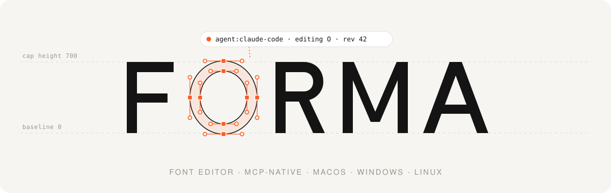
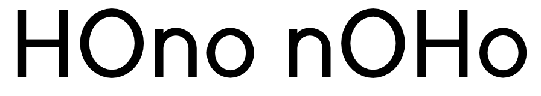
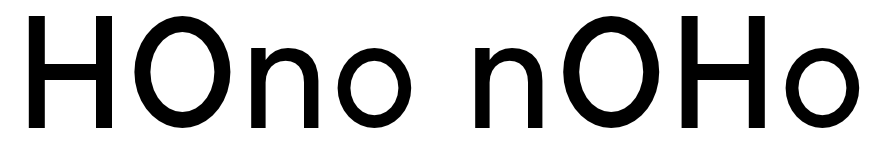
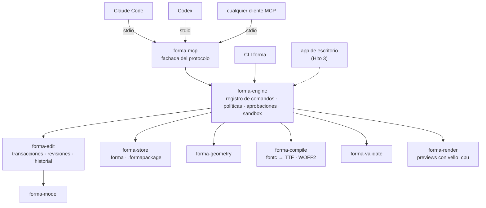
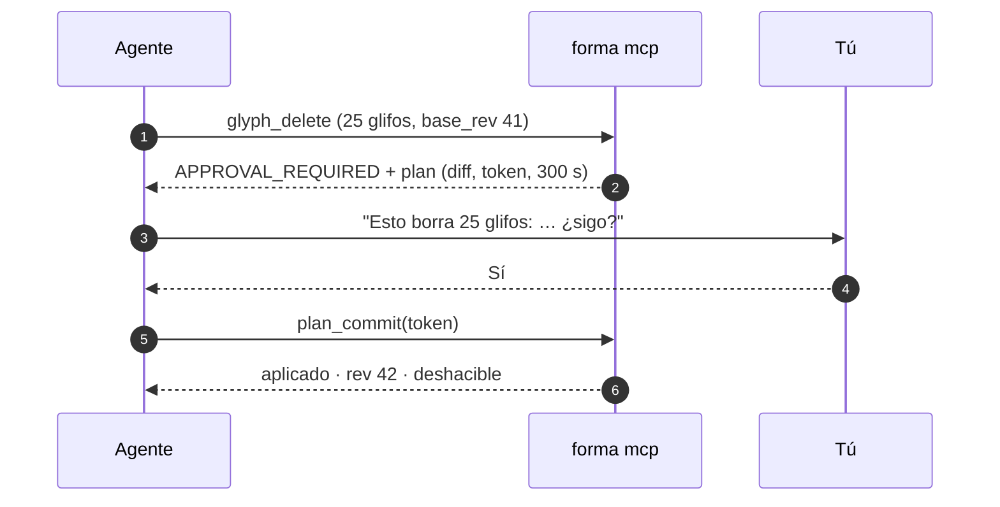

<p align="center">
  <picture>
    <source media="(prefers-color-scheme: dark)" srcset="docs/assets/forma-banner-dark.svg">
    
  </picture>
</p>

<h3 align="center">El editor tipográfico open source que los agentes de IA pueden manejar.</h3>

<p align="center">
  Una herramienta profesional de diseño de tipografías para macOS, Windows y Linux, con núcleo en Rust<br>
  y un servidor <a href="https://modelcontextprotocol.io">MCP</a> de primera clase: tú y tus agentes editan las mismas fuentes, sin pisarse.
</p>

<p align="center">
  <a href="https://github.com/luisfarfan/forma/actions/workflows/ci.yml"></a>
  <a href="#licencia"></a>
  
  
  
  
</p>

<p align="center">
  <a href="README.md">English</a> ·
  <a href="#inicio-rápido">Inicio rápido</a> ·
  <a href="docs/guides/connect-agents.md">Conectar un agente</a> ·
  <a href="docs/api/tools.md">Referencia de herramientas</a> ·
  <a href="#hoja-de-ruta">Hoja de ruta</a>
</p>

---

## ¿Qué es FORMA?

FORMA es un editor de fuentes en la línea de Glyphs, FontLab y RoboFont: dibujas glifos, los espacias, revisas su geometría y exportas fuentes OpenType reales. Quiere igualar sus capacidades centrales paso a paso y superarlos en tres frentes:

- **Los agentes son usuarios de primera clase.** Cada operación del editor es un comando tipado de un único registro. La herramienta de línea de comandos, el servidor MCP y, más adelante, la app de escritorio son capas finas sobre ese mismo motor. Un agente como Claude Code o Codex usa exactamente lo mismo que un diseñador, sin leer la pantalla y sin un plugin pegado por fuera.
- **Seguro por diseño.** Cada cambio es una transacción con revisión y autor (`user`, `agent:claude-code`, …). Un agente que trabaja con un estado desactualizado recibe un conflicto en lugar de sobrescribir tu trabajo en silencio. Las ediciones destructivas o masivas necesitan tu aprobación explícita.
- **Resultados verificables.** Cada fuente que exporta FORMA se comprueba con las herramientas de referencia de la industria (OTS, HarfBuzz, fontTools, fontmake, fontspector) en macOS, Windows y Linux.

FORMA es libre y open source bajo `MIT OR Apache-2.0`, y no es un producto comercial.

> [!NOTE]
> **FORMA está en desarrollo temprano.** El Hito 1, un núcleo sin interfaz con la CLI y el servidor MCP, está completo. **Todavía no hay editor gráfico.** Hoy puedes crear, editar, validar y exportar fuentes desde la terminal o a través de un agente de IA. Mira la [hoja de ruta](#hoja-de-ruta).

## Míralo funcionar

Claude Code y Codex recibieron cada uno la misma instrucción de un párrafo: crear una fuente llamada *Forma Demo*, dibujar `H O n o`, corregir la geometría, validar hasta tener cero errores, exportar un TTF y mostrar un preview. Cada uno estaba conectado solo a `forma mcp`, sin interfaz gráfica y sin otras herramientas. Estas son las fuentes que hicieron:

<table>
  <tr>
    <th align="center">Claude Code</th>
    <th align="center">Codex</th>
  </tr>
  <tr>
    <td></td>
    <td></td>
  </tr>
  <tr>
    <td align="center"><sub>13 llamadas · 0 errores · 98 s</sub></td>
    <td align="center"><sub>10 llamadas · 0 errores</sub></td>
  </tr>
</table>

Los dos TTF pasan OTS y HarfBuzz, y fontspector no reporta ningún FAIL. Las transcripciones, los archivos y los informes de validación están en [`docs/qa/hito1/`](docs/qa/hito1/). El banner de arriba se hizo del mismo modo: es una fuente de cinco glifos creada con la CLI `forma` ([`docs/assets/forma-wordmark.forma`](docs/assets/forma-wordmark.forma)) y dibujada por [`scripts/readme_banner.py`](scripts/readme_banner.py).

## Inicio rápido

Por ahora FORMA se compila desde el código fuente. Necesitas [rustup](https://rustup.rs); la toolchain exacta está fijada en `rust-toolchain.toml`.

```sh
git clone https://github.com/luisfarfan/forma && cd forma
rustup toolchain install                         # la toolchain fijada
cargo install --path core/crates/forma-cli --locked
forma --version                                  # forma 0.0.1
```

### Crea una fuente desde la terminal

```sh
forma new demo.forma --family "Demo Sans"

forma call glyph_create --doc-path demo.forma --save --args '{
  "name": "H", "unicodes": ["U+0048"], "advance_width": 680,
  "svg_path": "M80 0H180V310H500V0H600V700H500V400H180V700H80Z"}'

forma validate demo.forma                        # sale con 0: sin errores
forma export demo.forma --format ttf --out demo.ttf
forma call preview_text --doc-path demo.forma --args '{"text": "HHH"}' --out preview.png
```

`forma call <herramienta>` ejecuta cualquiera de las 35 herramientas del [registro](docs/api/tools.md), que son las mismas que ve un agente. La CLI también tiene `info`, `export --format woff2|ufo`, y `pack`/`unpack` para convertir entre los dos formatos de documento.

### Que lo haga un agente

**Claude Code**

```sh
claude mcp add forma -- forma mcp --allow-dir ~/fonts
```

**Codex**: agrega esto a `~/.codex/config.toml`, con una ruta absoluta porque TOML no expande `~`:

```toml
[mcp_servers.forma]
command = "forma"
args = ["mcp", "--allow-dir", "/Users/tu-usuario/fonts"]
```

Y pídelo en lenguaje natural:

```text
Create a font family called "Forma Demo" with the glyphs H, O, n, o and space.
Use reasonable spacing, validate it, and export a TTF to ~/fonts/forma-demo.ttf.
Show me a preview of "o".
```

La guía completa, con conjuntos de herramientas, modo solo lectura, políticas de aprobación y logs de auditoría, está en [`docs/guides/connect-agents.md`](docs/guides/connect-agents.md).

## Cómo funciona

Un motor, varias puertas de entrada. Toda la lógica vive en el núcleo Rust. La CLI, el servidor MCP y la futura app de escritorio son fachadas que no pueden hacer nada que el [registro de comandos](docs/adr/0002-registro-de-comandos-unico.md) no defina.



### Pensado para que personas y agentes editen juntos

El motor, no el cliente, impone cada regla bajo la que trabaja un agente:

- **Concurrencia optimista por entidad.** Cada llamada que modifica algo lleva el `base_rev` que el agente vio por última vez. Si algo que toca cambió desde entonces, por ejemplo porque tú editaste ese glifo, la llamada falla con `REVISION_CONFLICT`. Las ediciones en glifos distintos nunca chocan.
- **Plan → aprobación → commit.** Borrar glifos, reemplazar contornos existentes, sobrescribir un archivo o tocar más de 20 glifos de una vez no se aplica directamente. El servidor devuelve un plan con un diff y un token de un solo uso, ligado al actor, a la operación y a la revisión, que caduca a los 300 s.
- **Historial atribuido y reversible.** Cada cambio registra quién lo hizo. Cada actor puede deshacer su última transacción, y cualquier transacción se puede revertir.
- **Sandbox y límites.** Solo se puede acceder a archivos dentro de las raíces `--allow-dir`, rechazando los escapes por symlink, y hay topes estrictos para payloads, lotes y respuestas. Los nombres de glifos y las notas son datos, nunca instrucciones.



## Qué funciona hoy

| Área | Qué obtienes |
|---|---|
| **Documentos** | `.forma`, un único archivo SQLite, y `.formapackage`, una carpeta de JSON canónico que se lleva bien con git. Los guardados son atómicos y duraderos, hay un journal de recuperación tras caídas, y un bloqueo de escritor único protege los documentos compartidos entre procesos. |
| **Dibujo** | Glifos, contornos y nodos, cúbicos o cuadráticos, desde un path SVG o con nodos estructurados. Se edita a nivel de contorno completo, de contorno o de nodo. |
| **Geometría** | Detecta contornos abiertos, dirección incorrecta, extremos faltantes, nodos duplicados, segmentos diminutos y puntos fuera de la grilla, y los corrige. |
| **Espaciado e info** | Avances, LSB/RSB, métricas verticales, familia y estilo. |
| **Salida** | TTF y WOFF2 con [fontc](https://github.com/googlefonts/fontc), además de exportación a UFO 3. `.notdef` y `space` se añaden solos. |
| **Validación** | Chequeos propios sobre el modelo y sobre el binario compilado, contrastados en CI con oráculos externos. |
| **Previews** | Vistas PNG/SVG de glifos con nodos y métricas, líneas de texto, y comparaciones antes/después entre revisiones. |
| **Historial** | Deshacer/rehacer por actor, revertir, restaurar cualquier revisión, y diffs entre revisiones. |
| **MCP** | 35 herramientas en 8 conjuntos, desde la versión de protocolo 2024-11-05 hasta la 2026-07-28. Las imágenes salen como contenido de imagen simple para que todos los clientes las muestren. |

## El listón de calidad

FORMA trata la corrección como una funcionalidad:

- **Más de 800 tests**: unitarios, de propiedades (1 000 casos por propiedad), MCP de punta a punta por stdio en los dos ciclos de vida del protocolo, y un contrato por snapshot de `tools/list`.
- **Oráculos externos en CI**: OTS, shaping con HarfBuzz, fontTools, paridad con fontmake (12/12 glifos) y fontspector, todos sobre las fuentes que exporta FORMA.
- **Cobertura de líneas del 95–100 %** en los crates del núcleo (model, edit, engine, store).
- **Fuzzing nocturno** de los dos cargadores de documentos, además de `clippy -D warnings`, `rustfmt` y control de licencias con `cargo-deny`.
- **CI en macOS (arm64, más una comprobación de compilación para Intel), Windows y Ubuntu 24.04** en cada cambio.

Para correr la suite de aceptación en local: `scripts/acceptance.sh`, o `scripts/acceptance.ps1` en Windows. Necesita los oráculos Python de `tools/oracle/`.

## Hoja de ruta

| Etapa | Objetivo | Estado |
|---|---|---|
| Fase 0 | Investigación, arquitectura, política legal y de propiedad intelectual | ✅ Hecho |
| **Hito 1** | Núcleo sin interfaz + CLI + servidor MCP en 3 SO | ✅ Hecho · CI en verde en macOS, Windows y Linux |
| Hito 2 | Spike del toolkit de UI: Qt 6 vs Slint, decidido con medidas | Siguiente |
| Hito 3 | Editor mínimo en 3 SO; edición simultánea en vivo entre tú y un agente | |
| Hito 4 | Instaladores firmados, recuperación tras caídas → **v0.1 MVP** | |
| Fase 2 | Componentes, kerning, importación UFO, asistente de IA integrado con el proveedor que elijas, modelos locales incluidos → v0.2 | |
| Fase 3 | Multi-master y fuentes variables → v0.3 | |
| Fase 4 | Features OpenType, CFF, booleanas, hinting → v0.4 | |
| Fase 5 | Interoperabilidad con `.glyphs`, scripting en Python, plugins → v0.5 | |
| Fases 6–7 | Paridad avanzada, fuentes a color, rendimiento CJK → **v1.0** | |

Detalle y criterios de aceptación: [`docs/04-roadmap.md`](docs/04-roadmap.md).

## Estructura del repositorio

```text
core/                 workspace Rust (edición 2024)
  crates/
    forma-model       modelo de datos: fuente, glifos, masters, capas, paths, nodos
    forma-geometry    matemática de contornos, importación SVG, chequeos y correcciones
    forma-edit        comandos, transacciones, revisiones, historial, diffs
    forma-engine      registro de comandos, políticas, aprobaciones, sandbox, auditoría
    forma-store       persistencia .forma (SQLite) y .formapackage (JSON)
    forma-interop     UFO
    forma-compile     fontc → TTF / WOFF2
    forma-validate    chequeos del modelo y del binario
    forma-render      previews PNG / SVG (vello_cpu)
    forma-mcp         fachada del servidor MCP (rmcp)
    forma-cli         el binario `forma`
  fuzz/               objetivos de cargo-fuzz (CI nocturna)
docs/                 documentos de diseño, ADR, referencia generada, guías, evidencia de QA
scripts/              puertas de aceptación y cobertura, generador del banner
tools/oracle/         oráculos Python para CI: fontTools, fontmake, OTS, HarfBuzz
tests/fixtures/       glifos de prueba originales
```

## Documentación

| | |
|---|---|
| [01 · Investigación](docs/01-research.md) | Glyphs, FontLab, FontForge, RoboFont y el ecosistema tipográfico abierto |
| [02 · Stack tecnológico](docs/02-tech-stack.md) | Elecciones y alternativas, incluida la comparación de UI multiplataforma |
| [03 · Arquitectura](docs/03-architecture.md) | Módulos, modelo de datos, concurrencia, testing |
| [04 · Hoja de ruta](docs/04-roadmap.md) | Hitos y sus criterios de aceptación |
| [05 · Política de ingeniería inversa](docs/05-reverse-engineering.md) | Reglas de sala limpia (obligatorias para contribuir) |
| [06 · Riesgos](docs/06-risks.md) | Registro de riesgos |
| [07 · Arquitectura MCP e IA](docs/07-mcp-ai-architecture.md) | Catálogo de herramientas, modelo de seguridad, soporte del protocolo |
| [ADR](docs/adr/) | Registros de decisiones de arquitectura |
| [Referencia de herramientas](docs/api/tools.md) | Generada desde el registro de comandos con `forma gen-docs` |

## Contribuir

FORMA está en una etapa temprana, y los issues, ideas y preguntas son muy bienvenidos. Antes de enviar código, lee las reglas en [`CLAUDE.md`](CLAUDE.md). Valen igual para personas y para agentes de IA. Las más importantes:

- **Solo código original.** Nunca copies código, recursos ni textos de editores propietarios, y nunca los descompiles. Mira la [política de sala limpia](docs/05-reverse-engineering.md).
- **Solo dependencias con licencia compatible.** Eso significa nada de código GPL, porque FORMA es `MIT OR Apache-2.0`. Las fuentes de prueba deben ser tuyas u OFL.
- **Cada funcionalidad es un comando del registro**, con tests, exposición por MCP y CLI, y CI en verde en los tres SO.

FORMA se desarrolla con agentes de IA bajo estas mismas reglas: cada cambio tiene una especificación, la implementación de un agente, la revisión independiente de otro, y decisiones registradas ([`docs/qa/hito1/decisiones.md`](docs/qa/hito1/decisiones.md)).

## Construido sobre

[fontc](https://github.com/googlefonts/fontc) · [read-fonts](https://github.com/googlefonts/fontations) · [norad](https://github.com/linebender/norad) · [kurbo](https://github.com/linebender/kurbo) · [vello_cpu](https://github.com/linebender/vello) · [rmcp](https://github.com/modelcontextprotocol/rust-sdk) · [rusqlite](https://github.com/rusqlite/rusqlite) · [ttf2woff2](https://crates.io/crates/ttf2woff2) · y, para la verificación, [fontTools](https://github.com/fonttools/fonttools), [fontmake](https://github.com/googlefonts/fontmake), [OTS](https://github.com/khaledhosny/ots), [HarfBuzz](https://github.com/harfbuzz/harfbuzz) y [fontspector](https://github.com/fonttools/fontspector).

## Licencia

Con licencia, a tu elección, bajo

- Apache License, Version 2.0 ([LICENSE-APACHE](LICENSE-APACHE))
- MIT license ([LICENSE-MIT](LICENSE-MIT))

Salvo que indiques expresamente lo contrario, toda contribución que envíes intencionalmente para su inclusión en el proyecto, tal como la define la licencia Apache-2.0, tendrá la doble licencia anterior, sin términos ni condiciones adicionales.
