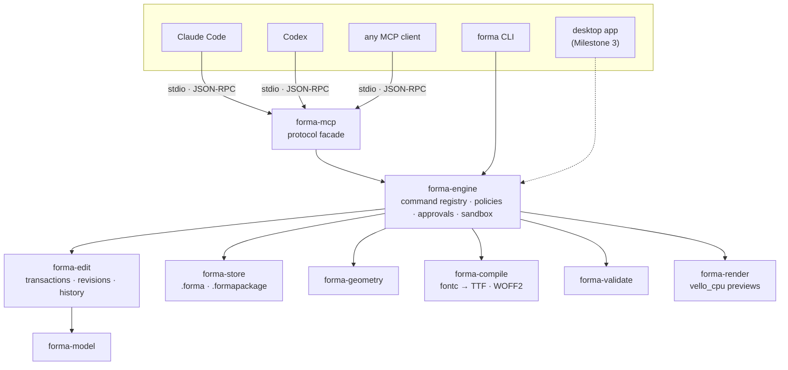
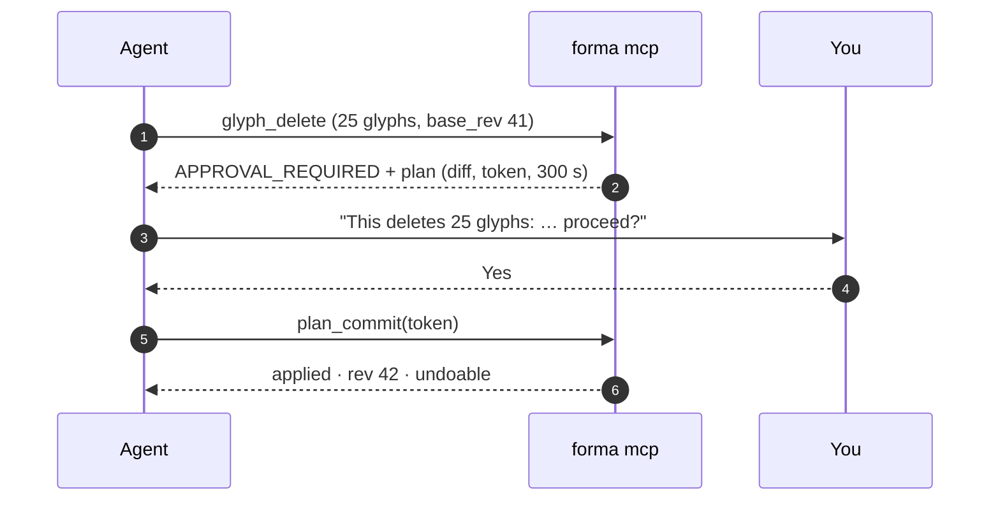

<p align="center">
  <picture>
    <source media="(prefers-color-scheme: dark)" srcset="docs/assets/forma-banner-dark.svg">
    
  </picture>
</p>

<h3 align="center">The open-source font editor that AI agents can drive.</h3>

<p align="center">
  A professional type design tool for macOS, Windows and Linux, built on a Rust core<br>
  with a first-class <a href="https://modelcontextprotocol.io">MCP</a> server: you and your agents edit the same fonts, safely.
</p>

<p align="center">
  <a href="https://github.com/luisfarfan/forma/actions/workflows/ci.yml"></a>
  <a href="#license"></a>
  
  
  
  
</p>

<p align="center">
  <a href="README.es.md">Español</a> ·
  <a href="#quick-start">Quick start</a> ·
  <a href="docs/guides/connect-agents.md">Connect an agent</a> ·
  <a href="docs/api/tools.md">Tool reference</a> ·
  <a href="#roadmap">Roadmap</a>
</p>

---

## What is FORMA?

FORMA is a font editor in the tradition of Glyphs, FontLab and RoboFont: draw glyphs, space them, check their geometry and export real OpenType fonts. It aims to match their core capabilities step by step, and to beat them in three areas:

- **Agents are first-class users.** Every operation of the editor is a typed command in one registry. The command-line tool, the MCP server and, later, the desktop app are thin layers over that same engine. An agent like Claude Code or Codex uses exactly what a designer uses, with no screen scraping and no plugin bolted onto the side.
- **Safe by construction.** Every change is a transaction with a revision and an author (`user`, `agent:claude-code`, …). An agent working from stale state gets a conflict instead of silently overwriting your work. Destructive or mass edits need your explicit approval.
- **Verifiable output.** Every font FORMA exports is checked against the industry's own tools (OTS, HarfBuzz, fontTools, fontmake, fontspector) on macOS, Windows and Linux.

FORMA is free and open source under `MIT OR Apache-2.0`, and it is not a commercial product.

> [!NOTE]
> **FORMA is in early development.** Milestone 1, a headless core with the CLI and the MCP server, is complete. **There is no graphical editor yet.** Today you can build, edit, validate and export fonts from the terminal or through an AI agent. See the [roadmap](#roadmap).

## See it work

Claude Code and Codex each got the same one-paragraph prompt: create a font called *Forma Demo*, draw `H O n o`, fix the geometry, validate until there are zero errors, export a TTF and show a preview. Each was connected only to `forma mcp`, with no GUI and no other tools. These are the fonts they made:

<table>
  <tr>
    <th align="center">Claude Code</th>
    <th align="center">Codex</th>
  </tr>
  <tr>
    <td></td>
    <td></td>
  </tr>
  <tr>
    <td align="center"><sub>13 tool calls · 0 errors · 98 s</sub></td>
    <td align="center"><sub>10 tool calls · 0 errors</sub></td>
  </tr>
</table>

Both TTFs pass OTS and HarfBuzz, and fontspector reports 0 FAIL. Transcripts, files and validation reports are in [`docs/qa/hito1/`](docs/qa/hito1/). The banner at the top was drawn the same way: it is a five-glyph font made with the `forma` CLI ([`docs/assets/forma-wordmark.forma`](docs/assets/forma-wordmark.forma)), rendered by [`scripts/readme_banner.py`](scripts/readme_banner.py).

## Quick start

FORMA builds from source for now. You need [rustup](https://rustup.rs); the exact toolchain is pinned in `rust-toolchain.toml`.

```sh
git clone https://github.com/luisfarfan/forma && cd forma
rustup toolchain install                         # the pinned toolchain
cargo install --path core/crates/forma-cli --locked
forma --version                                  # forma 0.0.1
```

### Make a font from the terminal

```sh
forma new demo.forma --family "Demo Sans"

forma call glyph_create --doc-path demo.forma --save --args '{
  "name": "H", "unicodes": ["U+0048"], "advance_width": 680,
  "svg_path": "M80 0 L180 0 L180 310 L500 310 L500 0 L600 0 L600 700 L500 700 L500 400 L180 400 L180 700 L80 700 Z"}'

forma validate demo.forma                        # exit 0: no errors
forma export demo.forma --format ttf --out demo.ttf
forma call preview_text --doc-path demo.forma --args '{"text": "HHH"}' --out preview.png
```

`forma call <tool>` runs any of the 35 tools of the [registry](docs/api/tools.md), which are the same tools an agent sees. The CLI also has `info`, `export --format woff2|ufo`, and `pack`/`unpack` to convert between the two document formats.

### Let an agent do it

**Claude Code**

```sh
claude mcp add forma -- forma mcp --allow-dir ~/fonts
```

**Codex**: add this to `~/.codex/config.toml`, using an absolute path because TOML does not expand `~`:

```toml
[mcp_servers.forma]
command = "forma"
args = ["mcp", "--allow-dir", "/Users/you/fonts"]
```

Then ask in plain language:

```text
Create a font family called "Forma Demo" with the glyphs H, O, n, o and space.
Use reasonable spacing, validate it, and export a TTF to ~/fonts/forma-demo.ttf.
Show me a preview of "o".
```

The full guide, including toolsets, read-only mode, approval policies and audit logs, is in [`docs/guides/connect-agents.md`](docs/guides/connect-agents.md).

## How it works

One engine, many front ends. All logic lives in the Rust core. The CLI, the MCP server and the future desktop app are facades that cannot do anything the [command registry](docs/adr/0002-registro-de-comandos-unico.md) does not define.



### Built for humans and agents editing together

The engine, not the client, enforces every rule an agent works under:

- **Optimistic concurrency per entity.** Each mutating call carries the `base_rev` the agent last saw. If something it touches changed since then, for example because you edited that glyph, the call fails with `REVISION_CONFLICT`. Edits to different glyphs never conflict.
- **Plan → approve → commit.** Deleting glyphs, replacing existing outlines, overwriting a file or touching more than 20 glyphs at once is not applied directly. The server returns a plan with a diff and a single-use token that is bound to the actor, the operation and the revision, and that expires after 300 s.
- **Attributed, reversible history.** Every change records who made it. Each actor can undo their own last transaction, and any transaction can be reverted.
- **Sandboxed and bounded.** Files are reachable only inside `--allow-dir` roots, with symlink escapes refused, and payloads, batches and responses have hard limits. Glyph names and notes are treated as data, never as instructions.



## What works today

| Area | What you get |
|---|---|
| **Documents** | `.forma`, a single SQLite file, and `.formapackage`, a folder of canonical JSON that diffs well in git. Saves are atomic and durable, there is a crash-recovery journal, and a single-writer lock protects documents shared between processes. |
| **Drawing** | Glyphs, contours and nodes, cubic or quadratic, from SVG path data or structured nodes. Edits work at the level of the whole outline, a contour or a node. |
| **Geometry** | Detects open contours, wrong direction, missing extremes, duplicate nodes, tiny segments and off-grid points, and fixes them. |
| **Spacing & info** | Advance widths, LSB/RSB, vertical metrics, family and style info. |
| **Output** | TTF and WOFF2 through [fontc](https://github.com/googlefonts/fontc), plus UFO 3 export. `.notdef` and `space` are added automatically. |
| **Validation** | Built-in checks on the model and on the compiled binary, cross-checked in CI by external oracles. |
| **Previews** | PNG/SVG glyph views with nodes and metrics, lines of text, and before/after comparisons between revisions. |
| **History** | Undo/redo per actor, revert, restore to any revision, and diffs between revisions. |
| **MCP** | 35 tools in 8 toolsets, from protocol version 2024-11-05 to 2026-07-28. Images go out as plain image content so every client can show them. |

## Quality bar

FORMA treats correctness as a feature:

- **800+ tests**: unit, property-based (1,000 cases per property), MCP end-to-end over stdio in both protocol lifecycles, and a snapshot contract for `tools/list`.
- **External oracles in CI**: OTS, HarfBuzz shaping, fontTools, fontmake parity (12/12 glyphs) and fontspector, all run on the fonts FORMA exports.
- **Line coverage of 95–100 %** across the core crates (model, edit, engine, store).
- **Nightly fuzzing** of both document loaders, plus `clippy -D warnings`, `rustfmt` and license checks with `cargo-deny`.
- **CI on macOS (arm64, plus an Intel build check), Windows and Ubuntu 24.04** for every change.

Run the acceptance suite locally with `scripts/acceptance.sh`, or `scripts/acceptance.ps1` on Windows. It needs the Python oracles in `tools/oracle/`.

## Roadmap

| Stage | Goal | Status |
|---|---|---|
| Phase 0 | Research, architecture, legal and IP policy | ✅ Done |
| **Milestone 1** | Headless core + CLI + MCP server on 3 OSes | ✅ Implemented · cross-OS CI is the closing gate |
| Milestone 2 | UI toolkit spike: Qt 6 vs Slint, decided by measurements | Next |
| Milestone 3 | Minimal editor on 3 OSes; live co-editing between you and an agent | |
| Milestone 4 | Signed installers, crash recovery → **v0.1 MVP** | |
| Phase 2 | Components, kerning, UFO import, built-in AI assistant with your choice of provider, local models included → v0.2 | |
| Phase 3 | Multi-master and variable fonts → v0.3 | |
| Phase 4 | OpenType features, CFF, booleans, hinting → v0.4 | |
| Phase 5 | `.glyphs` interoperability, Python scripting, plugins → v0.5 | |
| Phases 6–7 | Advanced parity, color fonts, CJK performance → **v1.0** | |

Details and acceptance criteria: [`docs/04-roadmap.md`](docs/04-roadmap.md).

## Repository layout

```text
core/                 Rust workspace (edition 2024)
  crates/
    forma-model       data model: font, glyphs, masters, layers, paths, nodes
    forma-geometry    outline math, SVG import, checks and fixes
    forma-edit        commands, transactions, revisions, history, diffs
    forma-engine      command registry, policies, approvals, sandbox, audit
    forma-store       .forma (SQLite) and .formapackage (JSON) persistence
    forma-interop     UFO
    forma-compile     fontc → TTF / WOFF2
    forma-validate    model and binary checks
    forma-render      PNG / SVG previews (vello_cpu)
    forma-mcp         MCP server facade (rmcp)
    forma-cli         the `forma` binary
  fuzz/               cargo-fuzz targets (nightly CI)
docs/                 design docs, ADRs, generated tool reference, guides, QA evidence
scripts/              acceptance and coverage gates, banner generator
tools/oracle/         Python oracles for CI: fontTools, fontmake, OTS, HarfBuzz
tests/fixtures/       original test glyphs
```

## Documentation

The design documents are written in Spanish.

| | |
|---|---|
| [01 · Research](docs/01-research.md) | Glyphs, FontLab, FontForge, RoboFont and the open font ecosystem |
| [02 · Tech stack](docs/02-tech-stack.md) | Choices and alternatives, including the cross-platform UI comparison |
| [03 · Architecture](docs/03-architecture.md) | Modules, data model, concurrency, testing |
| [04 · Roadmap](docs/04-roadmap.md) | Milestones and their acceptance criteria |
| [05 · Reverse-engineering policy](docs/05-reverse-engineering.md) | Clean-room rules (mandatory for contributors) |
| [06 · Risks](docs/06-risks.md) | Risk register |
| [07 · MCP & AI architecture](docs/07-mcp-ai-architecture.md) | Tool catalog, security model, protocol support |
| [ADRs](docs/adr/) | Architecture decision records |
| [Tool reference](docs/api/tools.md) | Generated from the command registry by `forma gen-docs` |

## Contributing

FORMA is at an early stage, and issues, ideas and questions are very welcome. Before sending code, read the ground rules in [`CLAUDE.md`](CLAUDE.md). They apply to people and to AI agents alike. The most important ones:

- **Original code only.** Never copy code, assets or text from proprietary editors, and never decompile them. See the [clean-room policy](docs/05-reverse-engineering.md).
- **License-compatible dependencies only.** That means no GPL code, because FORMA is `MIT OR Apache-2.0`. Test fonts must be your own or OFL.
- **Every feature is a registry command** with tests, MCP and CLI exposure, and green CI on all three OSes.

FORMA itself is developed with AI coding agents under these same rules: each change has a spec, an implementation by one agent, an independent review by another, and recorded decisions ([`docs/qa/hito1/decisiones.md`](docs/qa/hito1/decisiones.md)).

## Built on

[fontc](https://github.com/googlefonts/fontc) · [read-fonts](https://github.com/googlefonts/fontations) · [norad](https://github.com/linebender/norad) · [kurbo](https://github.com/linebender/kurbo) · [vello_cpu](https://github.com/linebender/vello) · [rmcp](https://github.com/modelcontextprotocol/rust-sdk) · [rusqlite](https://github.com/rusqlite/rusqlite) · [ttf2woff2](https://crates.io/crates/ttf2woff2) · and, for verification, [fontTools](https://github.com/fonttools/fonttools), [fontmake](https://github.com/googlefonts/fontmake), [OTS](https://github.com/khaledhosny/ots), [HarfBuzz](https://github.com/harfbuzz/harfbuzz) and [fontspector](https://github.com/fonttools/fontspector).

## License

Licensed under either of

- Apache License, Version 2.0 ([LICENSE-APACHE](LICENSE-APACHE))
- MIT license ([LICENSE-MIT](LICENSE-MIT))

at your option.

Unless you explicitly state otherwise, any contribution intentionally submitted for inclusion in the work by you, as defined in the Apache-2.0 license, shall be dual licensed as above, without any additional terms or conditions.
