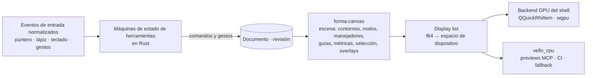

# 02 — Comparación tecnológica y stack recomendado

> Estado: revisión 3 (open source) · 2026-10-16
> **Aprobado por el responsable:** Rust como núcleo; Hitos 1 y 2; FORMA es **open source bajo MIT OR Apache-2.0**, sin fines comerciales. **Pendiente de aprobación:** tecnología de UI (§4), que se decide con un spike comparativo al final del roadmap (`04-roadmap.md`, Hito 8; ADR 0008).
> Evidencia: **[V]** verificado en fuente primaria (URL en §12) · **[A]** afirmación del proveedor · **[H]** hipótesis o juicio de ingeniería.

## 1. Resumen de decisiones

| Capa | Recomendación | Estado | Alternativas |
|---|---|---|---|
| Núcleo tipográfico | **Rust** (workspace `forma-*`): fontc, fontations, norad, kurbo, HarfRust | **Aprobado** | — |
| Interfaz gráfica (macOS, Windows, Linux) | **Qt 6.12 LTS + Qt Quick/QML**, núcleo enlazado con **cxx-qt** | **Recomendado; se confirma con spike** | Slint 1.18 (todo Rust; sin presión de lápiz); GPUI + gpui-kit (todo Rust; pre-1.0) |
| Canvas de glifos | **Núcleo de canvas propio en Rust** (`forma-canvas`): escena, hit-testing y herramientas, independiente del toolkit; render con backend GPU del toolkit y **vello_cpu** para previews headless | Recomendado | skia-safe como renderer único |
| MCP | **rmcp 3.5.x** (SDK oficial Rust): stdio, ambas eras del protocolo | Recomendado | `pmcp` |
| Agente IA integrado | Bucle propio en Rust + **genai** detrás de un trait `LlmProvider` | Recomendado | rig-core (conflicto rmcp ^2) |
| Formato nativo | **`.forma`**: archivo único SQLite. **`.formapackage`**: carpeta con JSON canónico para git | Recomendado | Zip de JSON (como Sketch); solo carpeta |
| Compilación | **fontc 1.0** in-process (TTF, VF-TTF); fontmake como oráculo de pruebas y ruta CFF (Hito 6) | Recomendado | fontmake como ruta única |
| Validación | OTS (`opentype-sanitizer`) + fontspector + chequeos propios | Recomendado | — |
| Distribución | macOS universal firmado y notarizado; Windows firmado (MSIX/MSI); Linux AppImage + Flatpak + deb; además Homebrew, winget y Flathub; la CLI vía `cargo install` | Recomendado | — |
| Licencia del proyecto | **MIT OR Apache-2.0**; dependencias permisivas, más Qt bajo LGPLv3 con enlace dinámico si se elige Qt | **Aprobado** | — |

**Por qué se descarta SwiftUI/AppKit como UI principal:** limita el producto a macOS. La propuesta anterior ya ponía toda la lógica en Rust, así que el cambio de UI **no** afecta al núcleo. Esa fue la razón para separar núcleo y shell desde el principio.

## 2. Ecosistema tipográfico (revisión 1, con `linesweeper` añadido en el Hito 2)

| Componente | Versión · fecha | Licencia | Relevancia |
|---|---|---|---|
| fontc | 1.0.0 · 2026-09-01 | Apache-2.0/MIT | Compilador Rust; ~89 % idéntico a fontmake en ~3 450 fuentes; **solo TrueType** (sin CFF/CFF2 ni instancias estáticas) [V] |
| fontations (read-fonts / write-fonts / skrifa) | 0.45 / 0.54 / 0.48 | MIT/Apache | En producción en Chrome [V] |
| norad | 0.19.2 | MIT/Apache | UFO3 [V] |
| kurbo | 0.13.1 | MIT/Apache | Geometría Bézier, sin booleanas [V] |
| HarfRust | 0.14.0 | MIT | Shaping; "<25 % más lento" que HarfBuzz [V] |
| fontTools / fontmake | 4.67.0 / 3.12.2 | MIT / Apache | Oráculos de prueba; ruta CFF [V] |
| linesweeper | 0.5.0 | MIT/Apache | Unión de contornos (`remove_overlap`) sobre kurbo; primera opción detrás del trait `PathOps` (ADR 0009) [V 2026-10-17] |
| Skia PathOps (skia-safe 0.153) | — | BSD/MIT | Booleanas robustas; plan B detrás del trait `PathOps` (ADR 0009) [V] |
| fontspector | 1.9.0 · 2026-10-09 | Apache-2.0 | Sucesor de Font Bakery; crates Rust disponibles [V] |
| opentype-sanitizer (OTS) | 9.2.0 | BSD | Wheels para macOS (universal2), Windows y Linux [V PyPI] |

Todas compilan en macOS, Windows y Linux (Rust puro, o C/C++ con builds soportados) [H: verificar en la CI del Hito 1].

## 3. Núcleo en Rust (aprobado): por qué permite "una sola lógica para tres SO y para agentes"

- **Toda** la lógica tipográfica vive en crates Rust sin dependencias de plataforma: modelo, edición e historial, geometría, interpolación, compilación, validación, render de previews y registro de comandos.
- El mismo binario de núcleo se enlaza en tres fachadas:

| Fachada | Cómo usa el núcleo |
|---|---|
| App gráfica | Vía cxx-qt (o el puente del toolkit elegido) |
| CLI `forma` | Directamente |
| Servidor MCP `forma mcp` | Directamente (es un subcomando de la misma CLI) |

- Las diferencias por SO se limitan a: ventana, input, menús, diálogos, empaquetado y ubicación de archivos y llaveros. Todas quedan en la capa shell o en crates de plataforma muy delgados (`forma-platform`).
- **La CI ejecuta la suite completa del núcleo y de MCP en los tres SO en cada PR.** Esto es lo que garantiza la equivalencia, no la buena voluntad.

## 4. Interfaz gráfica multiplataforma

### 4.1 Requisitos (prioridad del responsable: interfaz única, moderna, premium y extremadamente fluida)

- **Canvas Bézier:** 120 Hz sin saltos; zoom y paneo con trackpad (pinch), rueda y teclado; precisión subpíxel; antialiasing de calidad.
- **Entrada:** lápiz y tableta (presión, inclinación, hover), IME (nombres de glifos y texto de prueba en cualquier escritura), accesibilidad.
- **Escala:** grilla de miles de glifos con desplazamiento fluido; high-DPI y monitores mixtos.
- **Integración:** menús nativos (barra global en macOS), diálogos de archivos nativos.
- **Distribución:** empaquetado firmado y actualizaciones en los tres SO.
- **Licencia:** compatible con FORMA open source bajo MIT OR Apache-2.0, sin obligar a relicenciar el proyecto.

### 4.2 Comparación detallada

| | **Qt 6.12 LTS (Qt Quick/QML) + cxx-qt** | **Slint 1.18** | **Tauri 2.12** | **GPUI + gpui-kit** |
|---|---|---|---|---|
| Versión · fecha | 6.12.0 · 2026-09-30, LTS de 5 años [V] | 1.18.1 · 2026-09-21 [V] | 2.12.4 · 2026-10-14; 3.0 en alpha con Chromium embebido (CEF) [V] | gpui-kit 0.7.3 · 2026-10-12, fija `gpui-pre =0.3.9` [V] |
| Licencia | LGPLv3 / GPL / comercial (ver §4.3) [V] | GPLv3, royalty-free (desktop, **atribución obligatoria**) o comercial [V] | MIT/Apache [V] | Apache-2.0; "pre-1.0, often breaking changes" [V] |
| Integración con Rust | cxx-qt 0.10 (KDAB, MIT/Apache): QObjects definidos en Rust; "early development, API changes frequently" [V] | Nativa [V] | Nativa (backend), con IPC a JS [V] | Nativa [V] |
| Render | Scene graph RHI (Metal / D3D11/12 / Vulkan / OpenGL); `QQuickRhiItem` para render GPU propio [V] | femtovg, Skia, software; Vello experimental; interop wgpu tras `unstable-wgpu-30`, que cambia con cada versión mayor de wgpu [V] | WebView del sistema: WKWebView / WebView2 / **WebKitGTK** [V] | GPU propio (Metal / DirectX 11 / Vulkan) [V] |
| Precisión del canvas | Ítem propio alimentado desde Rust (f64 en geometría). **Evitar** el CurveRenderer de Qt Quick Shapes, que aproxima cúbicas con cuadráticas [V] | Vía wgpu propio (API inestable) | Canvas2D o WebGL; **sin WebGPU en WebKitGTK** [V] | Primitivas propias; path rendering limitado [H] |
| Lápiz y tableta | **`QTabletEvent`**: presión, inclinación, rotación, borrador; Windows Ink por defecto [V] | **No soportado** (issue #134 abierto desde 2020) [V] | Inconsistente: Safari reporta el lápiz Wacom como `mouse` [V]; WebKitGTK sin presión [H] | Solo Force Touch del trackpad, no lápiz [V] |
| IME / accesibilidad | Maduros; mejoras AT-SPI en 6.12 [V] | Issues abiertos de IME (#10861, #3811); accesibilidad en progreso [V] | Los del navegador | AccessKit en gpui-kit [V] |
| Menús y diálogos nativos | MenuBar nativo en macOS desde 6.8; diálogos nativos [V] | Barra de menús macOS vía muda [V] | Sí (plugins) [V] | Propios [H] |
| Linux | Sólido (X11 y Wayland) [H] | Sí | **Mantenedor de Tauri: "not a good idea for projects where Linux is a serious target"** [V] | Zed estable en Linux [V] |
| Empaquetado | macdeployqt, windeployqt (`--appx` en 6.12); AppImage/Flatpak con herramientas comunitarias [V] | Manual / cargo-bundle [H] | Excelente: dmg, MSI/NSIS, deb/rpm/AppImage/Flatpak/Snap, updater firmado [V] | Por cuenta propia [V] |
| Apps profesionales | **FontLab**, Krita 6, Maya 2025+, Substance 3D Painter [V] | LibrePCB 2.0 (sobre el backend Qt de Slint) [V] | Fontra usa web + PyQt, no Tauri [V] | Zed, Longbridge Pro [V/A] |
| Productividad | Tres lenguajes (Rust, QML, C++ mínimo); hot reload QML en 6.12 [V] | Un lenguaje + DSL `.slint` | Rust + TS/JS | Rust |

**Puntuación ponderada** (1–5; pesos: canvas ×3, look premium ×2, integración nativa ×2, madurez ×2, Rust ×1, licencia ×1, empaquetado ×1, productividad ×1; máximo 65):

| Qt 6.12 + cxx-qt | Tauri 2 | Slint 1.18 | GPUI + gpui-kit |
|---|---|---|---|
| **57** | 48 | 44 | 40 |

Otros candidatos, descartados con una línea:
- **iced 0.14:** "experimental"; base de COSMIC, pero débil en pulido de escritorio y lápiz [V].
- **egui:** modo inmediato; ideal para herramientas internas, no para un producto premium [V].
- **Flutter + flutter_rust_bridge:** añade un tercer lenguaje (Dart) [V/H].
- **Avalonia 12:** maduro, pero exige un puente Rust↔.NET [V].
- **Xilem/Masonry 0.4:** experimental [V].
- **Makepad 1.0:** ecosistema pequeño [V].
- **Dioxus Blitz:** beta [V].
- **Compose Multiplatform:** JVM + JNI [V].

### 4.3 Licencias de los toolkits con FORMA open source (MIT OR Apache-2.0)

FORMA es un proyecto **open source, sin fines comerciales**, bajo **MIT OR Apache-2.0** (decisión del responsable, 2026-10-16). Esto cambia el análisis respecto a la revisión anterior:

| Toolkit | Cómo se usa con FORMA | Obligaciones |
|---|---|---|
| **Qt 6 bajo LGPLv3 (gratis)** | Enlace **dinámico**. No hace falta licencia comercial | Distribuir avisos de licencia y ofrecer el código fuente de Qt (o enlazar a él); permitir sustituir las librerías de Qt [V]. Como el código de FORMA es abierto, el requisito de re-enlazado se cumple de forma natural |
| Qt: módulos solo GPL o comerciales | Canvas Painter, Graphs, Charts, Quick 3D, `qmlsc` [V] | **No usarlos**: obligarían a distribuir FORMA como GPL, incompatible con MIT/Apache. Lista de módulos permitidos en CI |
| Slint (licencia royalty-free 2.0) | Permitida para apps de escritorio | Atribución obligatoria (widget AboutSlint o badge) [V]. Su opción GPLv3 no es compatible con MIT/Apache |
| Tauri, GPUI | MIT/Apache | Ninguna especial |

Con esto **desaparece el costo de licencia** como criterio de desempate entre toolkits; queda solo el cumplimiento de la LGPL, que es sencillo para un proyecto abierto.

⚠ **Consecuencia práctica:** con Qt open source, las versiones de parche LTS posteriores a las primeras son **solo comerciales** [V]. FORMA tendría que seguir las versiones menores recientes de Qt 6.x en lugar de quedarse en una LTS, y planificar actualizaciones periódicas.

### 4.4 Recomendación

**Qt 6.12 LTS + Qt Quick/QML + cxx-qt, con canvas propio en Rust**, sujeto a un spike comparativo de 2 semanas (Hito 8) contra **Slint**.

Justificación:
1. **Es la única opción que hoy cubre lápiz/tableta, IME, accesibilidad, menús y diálogos nativos, high-DPI y empaquetado en los tres SO** [V]. Para un editor de dibujo profesional, la presión e inclinación del lápiz y el IME no son opcionales a medio plazo.
2. **Precedente directo:** FontLab, el competidor multiplataforma, está construido sobre Qt [V].
3. **El look premium y unificado no depende de widgets nativos.** Qt Quick permite un diseño propio idéntico en los tres SO; las críticas de "no se siente nativo" en macOS afectan sobre todo a los controles estándar [V], que no vamos a usar.
4. **El canvas no queda atado a Qt** (§5). Si el spike o la evolución del ecosistema favorecen otra opción, se reemplaza el shell, no la lógica.

**Riesgos de la recomendación:**
- Tres lenguajes en el shell.
- cxx-qt en "early development" [V].
- Cumplimiento de la LGPL (enlace dinámico; no usar módulos solo GPL).
- El ritmo de 120 Hz no está demostrado públicamente en ningún toolkit: hay que medirlo en el spike.

**Cuándo elegir la alternativa:**
- **Slint**, si el spike muestra un canvas igual de fluido y el responsable acepta "lápiz como ratón" (suficiente para Bézier; la presión solo importa para herramientas de trazo o pincel) a cambio de un stack 100 % Rust.
- **Tauri**, solo si Tauri 3 con Chromium embebido se estabiliza (resolvería Linux y la inconsistencia del lápiz) y se acepta el costo del IPC y del canvas web.

## 5. Arquitectura del canvas: independiente del toolkit

- **[D] La lógica de interacción del canvas vive en Rust** (`forma-canvas`): hit-testing con tolerancia en píxeles de pantalla, *snapping*, herramientas (selección, pluma, nodos, medición) como máquinas de estado y construcción de la escena. El shell solo entrega eventos normalizados y presenta la *display list*.
  - Resultado: el comportamiento de edición es **idéntico en los tres SO** y testeable sin UI.
  - El toolkit se vuelve reemplazable.
- **Render:**
  - **vello_cpu** (0.3.0, "the most mature choice" de la familia Vello [V]) para previews MCP, tests de snapshot y CI headless, deterministas en los tres SO.
  - En la app: backend GPU del shell (con Qt, un `QQuickRhiItem` o nodo del scene graph que dibuja la display list, o texturas renderizadas en Rust). Se mide en el spike.
  - Vello GPU sigue madurando [V]; `vello` (compute) es experimental [V].
- **Precisión:** geometría en `f64`. La transformación de vista se aplica en `f64` y solo las coordenadas finales de dispositivo pasan al renderer (`f32`). **No** se usan renderers que conviertan cúbicas en cuadráticas.
- **Lápiz y tableta:** con Qt, `QTabletEvent` [V]. Con un toolkit basado en winit, el soporte de lápiz en macOS y X11 aún no está fusionado (PRs #4593 y #4633 abiertos) [V].

## 6. MCP y agente integrado (detalle en `07-mcp-ai-architecture.md`)

- **rmcp 3.5.1** (Tier 1 oficial, Apache-2.0 en crates.io): implementa MCP 2026-07-28 y mantiene compatibilidad con 2025-11-25 y anteriores. Esto es imprescindible porque Codex negocia 2025-06-18 por defecto [V].
- **schemars** para generar los JSON Schemas de entrada y salida desde los tipos Rust del registro de comandos.
- **genai** 0.6.x (MIT/Apache) para Anthropic, OpenAI Responses, Gemini y Ollama/endpoints compatibles, detrás de un trait propio [V].
- Credenciales en el llavero del SO vía `keyring` [H: verificar versión al usarlo].

## 7. Formato nativo y extensión

| Aspecto | Hallazgo |
|---|---|
| `.forma` en registros de extensiones | No figura en fileinfo.com, file-extensions.org, IANA ni shared-mime-info [V] |
| Usos existentes de `.forma` | Proyectos pequeños en GitHub: un editor vectorial web (wieslawsoltes/Forma) y un lenguaje de programación (sfw/forma) [V]. Severidad **baja a moderada** |
| Carpeta como documento | Solo macOS la muestra como un archivo (`com.apple.package`). En Windows y Linux es una carpeta: no se abre con doble clic, hay que comprimirla para enviarla y se sincroniza a medias en la nube [V Apple/freedesktop + H] |
| Zip (como Sketch) | Hay que reescribir todo el archivo en cada guardado; riesgo si se cae a mitad [V sqlite.org/appfileformat] |
| SQLite como formato de aplicación | Transacciones atómicas a prueba de caídas, escrituras incrementales, un solo archivo [V]. Contras: binario para git; **WAL crea archivos `-wal`/`-shm` y no funciona en sistemas de archivos de red** [V]; riesgo en carpetas sincronizadas en la nube [V reportes] |

**[D] Doble representación, con el mismo esquema de entidades:**
- **`.forma`: archivo único SQLite** (formato por defecto).
  - Una fila por entidad, con JSON canónico.
  - `journal_mode=DELETE`, sin WAL, para no dejar archivos laterales.
  - Cabecera e `application_id` de SQLite propios para identificar el tipo por contenido.
  - En carpetas sincronizadas o de red, se guarda escribiendo una copia local y haciendo un reemplazo atómico [H: calibrar en el Hito 1].
- **`.formapackage`: carpeta** con un JSON canónico por glifo, para git y revisión de cambios. En macOS se declara como paquete; en Windows y Linux se abre con "Abrir…" o con la CLI.
- **`forma pack` / `forma unpack`:** conversión sin pérdida entre ambos (los tests de round-trip lo garantizan). Sigue el precedente `.glyphs`/`.glyphspackage` de Glyphs [V] y `.ufo`/`.ufoz` de UFO [V].
- **Registro del tipo de archivo:**
  - macOS: `UTExportedTypeDeclarations` con un UTI reverse-DNS de la organización.
  - Windows: ProgID `Forma.Document.1` o asociación en el manifiesto MSIX.
  - Linux: XML de shared-mime-info + `MimeType=` en el `.desktop`.
  - MIME `application/vnd.<org>.forma+sqlite3`; registro en IANA opcional cuando el formato sea estable [V RFC 6838].

> **Conclusión sobre `.forma`:** técnicamente seguro. El riesgo relevante no es la extensión sino la **marca FORMA** (ver `06-risks.md`, L7).

## 8. Compilación y exportación

Sin cambios en lo esencial (detalle en `03-architecture.md §9`):
- **TTF y VF-TTF:** fontc in-process, a partir de designspace+UFO temporales generados con norad.
- **OTF/CFF y CFF2:** sidecar fontmake con CPython embebido (Hito 6) o AFDKO 5.
- **Validación:** OTS + fontspector + chequeos propios.
- **Oráculo de pruebas:** comparación contra fontmake con `ttx_diff`.

## 9. Plataformas objetivo y distribución

| SO | Objetivo | Paquete | Firma |
|---|---|---|---|
| macOS | Apple Silicon + Intel (binario universal) | `.dmg` | Developer ID + notarización |
| Windows | 10 22H2+ y 11, x64 (ARM64 posterior) | MSIX y/o MSI | Certificado de firma de código |
| Linux | Ubuntu 24.04+ (Wayland y X11); otras distros vía Flatpak | AppImage, Flatpak, `.deb` | Firma de repositorio y Flatpak |

- Versiones mínimas exactas: se fijan al elegir el toolkit (Qt 6.12 publica su matriz de plataformas) [H: verificar en el spike].
- Actualizaciones: a decidir en la fase de empaquetado (Sparkle/WinSparkle/Flatpak, o el updater del toolkit).
- **Python embebido multiplataforma (Hitos 6–7):** PyO3 + una distribución redistribuible de CPython por plataforma [H: evaluar python-build-standalone y su licencia].

## 10. Dependencias del Hito 1 (instalación autorizada, con justificación)

| Herramienta | Justificación | Alcance |
|---|---|---|
| `rustup` + toolchain estable fijada (`rust-toolchain.toml`) | Núcleo, CLI y servidor MCP | Desarrollo y CI |
| Crates: rmcp, schemars, serde, kurbo, norad, fontc, read-fonts/write-fonts, rusqlite (SQLite embebido), vello_cpu, thiserror, clap, proptest, insta | Funcionalidad del Hito 1; cada una se justifica en su ADR o PR | `Cargo.lock` |
| venv Python en `tools/oracle/` con fontTools, fontmake, opentype-sanitizer | **Solo pruebas**: oráculo de compilación, `ttx` y OTS | Desarrollo y CI; no se distribuye |
| fontspector (`cargo install` local al repo, o crate) | Validación de binarios | Desarrollo y CI |
| MCP Inspector (`npx @modelcontextprotocol/inspector`) | Smoke tests de MCP con la herramienta oficial | Desarrollo y CI (Node 24 ya instalado) |
| HarfBuzz `hb-shape` | Oráculo de shaping (ya instalado en macOS; apt/choco en CI) | Desarrollo y CI |
| **No se instala** Qt ni Slint hasta aprobar el Hito 8 (spike de UI; ADR 0008) | — | — |

## 11. Riesgos tecnológicos principales

Ver `06-risks.md`. Los más ligados al stack son:
- T1: fontc solo genera TrueType.
- T14: licencia de Qt / cxx-qt inmaduro.
- T15: el rendimiento del canvas no está demostrado en ningún toolkit.
- T16: la compatibilidad entre las dos eras de MCP.

## 12. Fuentes

- **Ecosistema tipográfico:** https://github.com/googlefonts/fontc/releases/tag/fontc-v1.0.0 · https://github.com/googlefonts/fontations · https://developer.chrome.com/blog/memory-safety-fonts · https://docs.rs/kurbo · https://github.com/linebender/norad · https://github.com/harfbuzz/harfrust · https://github.com/fonttools/fontspector · https://pypi.org/project/opentype-sanitizer/ · https://github.com/fonttools/skia-pathops
- **Qt:** https://wiki.qt.io/Qt_6.12_Release · https://qt.io/blog/qt-6.12-released · https://doc.qt.io/qt-6/whatsnew612.html · https://doc.qt.io/qt-6/qt-releases.html · https://www.qt.io/licensing/open-source-lgpl-obligations · https://www.qt.io/faq · https://www.qt.io/development/qt-for-small-business · https://doc.qt.io/qt-6/qtcanvaspainter-index.html · https://doc.qt.io/qt-6/qtqml-qml-script-compiler.html · https://doc.qt.io/qt-6/qml-qtquick-shapes-shape.html · https://doc.qt.io/qt-6/qquickrhiitem.html · https://doc.qt.io/qt-6/qtabletevent.html · https://doc.qt.io/qt-6/qml-qtquick-controls-menubar.html · https://bugreports.qt.io/browse/QTBUG-98647 · https://github.com/KDAB/cxx-qt
- **Apps en Qt:** https://forum.fontlab.com/fontlab-8/huion-tablets/ · https://www.phoronix.com/news/Krita-6.0-Released · https://blog.autodesk.io/maya-2025-api-update-guide/ · https://experienceleague.adobe.com/en/docs/substance-3d-dev/painter-python/tutorials/qt6-migration
- **Slint:** https://github.com/slint-ui/slint (LICENSES, CHANGELOG, issues #134, #10861, #3811, #6877) · https://slint.dev/pricing · https://slint.dev/blog/slint-1.18-released · https://docs.rs/slint/latest/slint/wgpu_30/ · https://librepcb.org/blog/2026-01-28_release_2.0.0/
- **Tauri:** https://github.com/tauri-apps/tauri/issues/14963 · https://github.com/tauri-apps/tauri/issues/3988 · https://github.com/tauri-apps/tauri/issues/15213 · https://v2.tauri.app/distribute/ · https://v2.tauri.app/develop/calling-frontend/ · https://bugs.webkit.org/show_bug.cgi?id=257694 · https://lists.w3.org/Archives/Public/public-pointer-events/2023JanMar/0071.html · Fontra: https://github.com/fontra/fontra · https://github.com/fontra/fontra-pak
- **GPUI y otros:** https://zed.dev/blog/zed-for-windows-is-here · https://github.com/longbridge/gpui-component · https://lwn.net/Articles/1050268/ · https://github.com/linebender/xilem · https://github.com/DioxusLabs/blitz · https://avaloniaui.net/whats-new/12-0
- **Renderers y entrada:** https://github.com/linebender/vello · https://github.com/linebender/tiny-skia · https://github.com/rust-skia/rust-skia · https://github.com/rust-windowing/winit/pull/4318 · https://github.com/rust-windowing/winit/pull/4593 · https://github.com/rust-windowing/winit/pull/4633
- **MCP y proveedores:** https://github.com/modelcontextprotocol/rust-sdk · https://crates.io/crates/rmcp · https://crates.io/crates/genai
- **Formato:** https://sqlite.org/appfileformat.html · https://sqlite.org/wal.html · https://sqlite.org/useovernet.html · https://developer.apple.com/library/archive/documentation/CoreFoundation/Conceptual/CFBundles/DocumentPackages/DocumentPackages.html · https://developer.apple.com/documentation/uniformtypeidentifiers/defining-file-and-data-types-for-your-app · https://learn.microsoft.com/en-us/windows/win32/shell/fa-progids · https://specifications.freedesktop.org/shared-mime-info/latest/ar01s02.html · https://unifiedfontobject.org/versions/ufo3/ · https://developer.sketch.com/file-format/ · https://datatracker.ietf.org/doc/html/rfc6838
