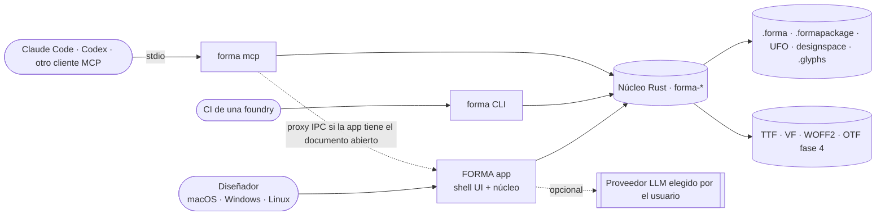
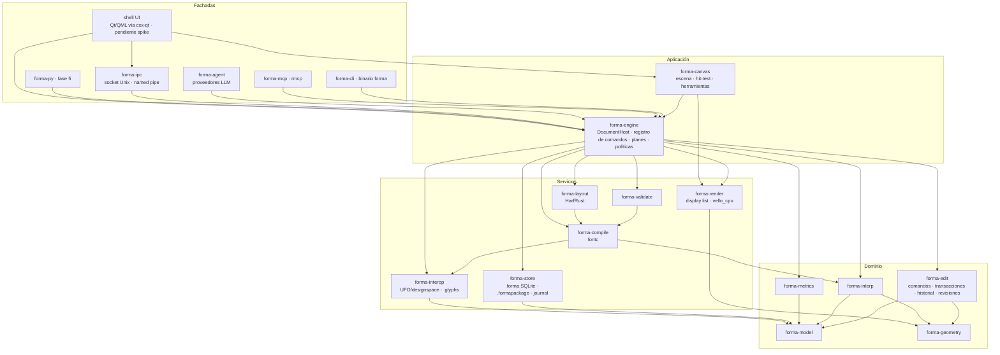
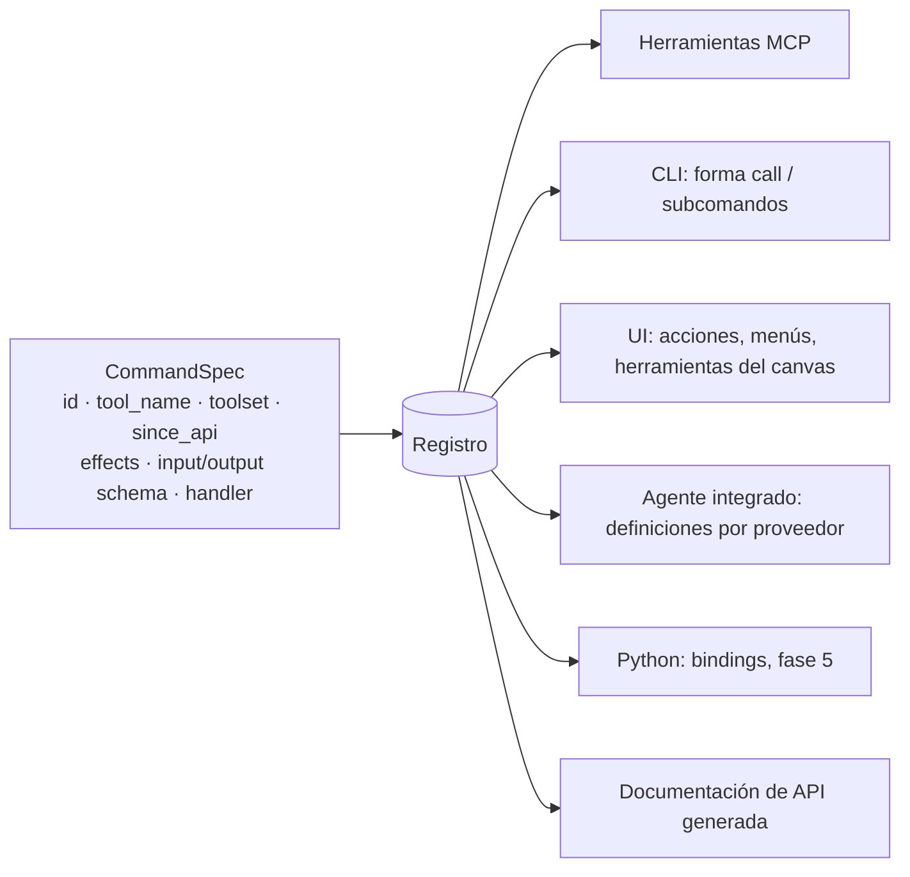
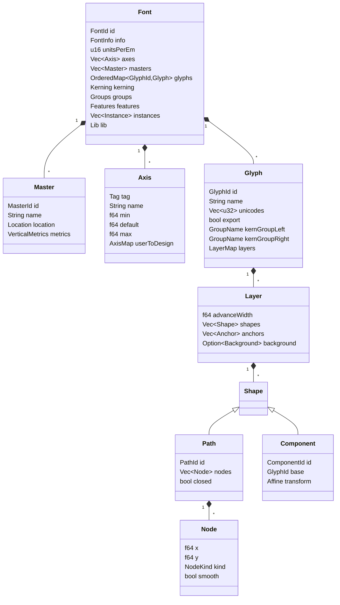
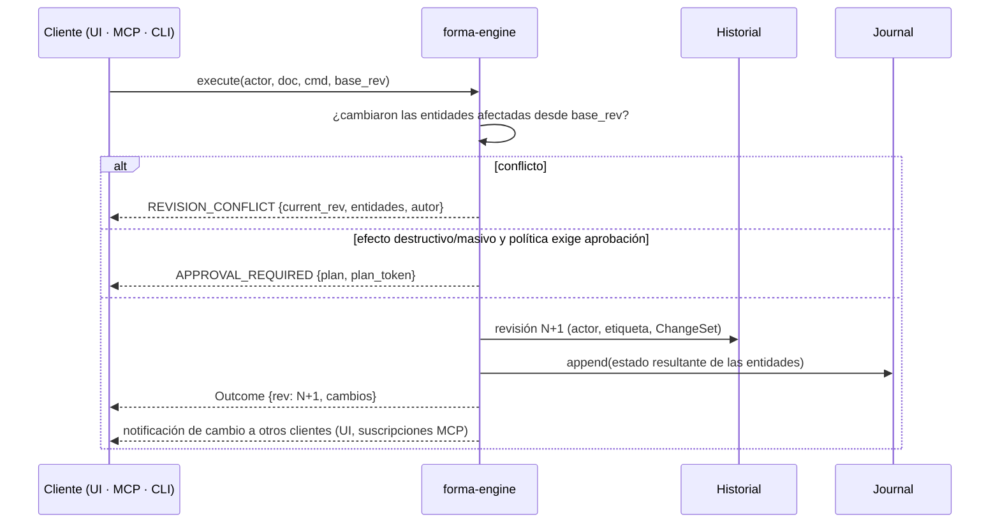
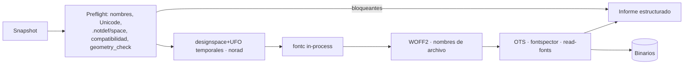

# 03 — Arquitectura propuesta

> Estado: revisión 2 (FORMA, multiplataforma, MCP central) · 2026-10-16
> Depende de: `02-tech-stack.md` (núcleo Rust aprobado; UI recomendada Qt 6.12 + cxx-qt, pendiente del spike) y `07-mcp-ai-architecture.md` (MCP/IA).
> Etiquetas: **[D]** decisión propuesta · **[ALT]** alternativa considerada · **[H]** supuesto a validar.

## 1. Principios

1. **Un solo núcleo y un solo registro de comandos.** Toda la lógica tipográfica vive en Rust. Cada operación del editor se declara una vez en el **registro de comandos**, del que derivan la UI, la CLI, el servidor MCP, el agente integrado y, más adelante, Python. Ninguna fachada contiene reglas del dominio.
2. **Multiplataforma por construcción.** El núcleo no depende de ningún SO. Lo específico de plataforma (ventanas, entrada, menús, diálogos, IPC, llavero, empaquetado) vive en el shell y en `forma-platform`. La CI ejecuta todo en macOS, Windows y Linux.
3. **Los agentes son usuarios de primera clase.** Todo lo que puede hacer la UI lo puede hacer un agente por MCP, sin la UI abierta, con las mismas garantías: transacciones, revisiones, undo y aprobaciones.
4. **Documento inmutable con revisiones.** Cada transacción produce una nueva revisión que comparte estructura con la anterior (`Arc`). Leer un snapshot es barato y seguro desde cualquier hilo, así que compilar, validar, previsualizar y dar respuestas a agentes no bloquea la edición.
5. **Precisión explícita.** El modelo usa `f64`. El redondeo es una operación explícita y testeada, nunca un efecto colateral de la entrada/salida.
6. **Interoperabilidad sin pérdidas silenciosas.** Los importadores y exportadores informan de lo que no pueden representar.
7. **Sin sobreingeniería.** Módulos = crates con fronteras claras; un solo proceso salvo donde hace falta (servidor MCP stdio, proxy hacia la app).

## 2. Contexto



## 3. Módulos (workspace Rust `core/`)



| Crate | Responsabilidad | Externos clave | Desde |
|---|---|---|---|
| `forma-model` | Tipos del dominio, IDs estables, revisión por entidad, invariantes | serde | Hito 1 |
| `forma-geometry` | Segmentos, bbox, transformaciones, extremos, dirección, hit-testing geométrico; trait `BooleanOps` | kurbo; Skia PathOps (F4) | Hito 1 |
| `forma-edit` | Comandos puros `apply(&Font, Cmd) -> (Font, ChangeSet)`, transacciones, gestos, historial, actores, control de concurrencia | — | Hito 1 |
| `forma-store` | `.forma` (SQLite), `.formapackage` (carpeta), escritura atómica, journal de recuperación, migraciones | rusqlite (SQLite embebido) | Hito 1 |
| `forma-interop` | Exportación UFO/designspace (Hito 1); importación UFO (F2); `.glyphs` v3/v4 (F5) | norad | Hito 1 |
| `forma-compile` | Preflight, generación de designspace+UFO intermedios, fontc, perfiles de exportación, WOFF2 | fontc, write-fonts | Hito 1 |
| `forma-validate` | Chequeos de modelo y geometría; binario (OTS, fontspector, read-fonts) | read-fonts, fontspector | Hito 1 |
| `forma-render` | Display list independiente del backend; rasterizado CPU determinista (PNG/SVG) para previews, MCP y tests | vello_cpu | Hito 1 |
| `forma-layout` | Shaping de texto de prueba | harfrust, skrifa | Hito 1 (básico) / F2 |
| `forma-engine` | `DocumentHost` (documentos abiertos, handles, bloqueo), **registro de comandos**, planes y aprobaciones, políticas, auditoría | schemars | Hito 1 |
| `forma-mcp` | Fachada MCP generada desde el registro: tools, resources, ambas eras del protocolo | rmcp | Hito 1 |
| `forma-cli` | Binario `forma`: subcomandos ergonómicos + `forma call <tool>` + `forma mcp` | clap | Hito 1 |
| `forma-ipc` | Protocolo local app ↔ `forma mcp` (sobres del registro) | interprocess [H] | Hito 3 |
| `forma-canvas` | Escena del editor, herramientas como máquinas de estado, entrada normalizada (puntero, lápiz, gestos) | — | Hito 2 (spike) / Hito 3 |
| `forma-agent` | Bucle de agente integrado; trait `LlmProvider` | genai | Fase 2 |
| `forma-platform` | Rutas de datos, llavero, bloqueo de archivos y detalles de SO | keyring [H] | Hito 1 (mínimo) |
| `forma-interp` | Ejes, avar, `VariationModel` verificado contra fontTools, compatibilidad, instancias | — | Fase 3 |
| `forma-metrics` | Espaciado, metrics keys, kerning y grupos | — | Hito 1 (básico) / F2 |
| shell UI | Ventanas, paneles, presentación del canvas, menús y diálogos | Qt 6.12 + cxx-qt (pendiente spike) | Hito 3 |

## 4. Registro de comandos (centro de la arquitectura)

Cada operación se declara una vez y de esa declaración se derivan todas las fachadas.



- **Entrada y salida tipadas** con serde + schemars. El JSON Schema se genera desde el tipo Rust, así que no hay schemas escritos a mano.
- **Efectos declarados:** `read_only`, `destructive`, `idempotent` y umbral `mass`. El motor los usa para aplicar políticas de aprobación (no confía en el cliente).
- **Ejecución:** `engine.execute(actor, doc, command, base_rev) -> Outcome | CommandError`.
  - Las fachadas solo traducen transporte ↔ registro.
  - El shell UI también llama a `execute`. Los gestos del canvas son transacciones abiertas del mismo motor.
- **Pruebas de paridad en CI:** todo `CommandSpec` está expuesto en MCP y CLI (salvo exclusión documentada); el snapshot de `tools/list` congela el contrato.

## 5. Modelo de datos tipográfico



- **[D] Modelo centrado en el glifo, con varios masters dentro de cada glifo.** Las capas por master (`LayerKey::Master`), las intermedias (`Intermediate(location)`), las alternativas (`Alternate(rules)`) y el fondo viven en el glifo. Así, compatibilidad, edición "todos los masters" y aislamiento de conflictos son locales.
  - **[ALT]** UFO+designspace como modelo nativo. Más interoperable, pero dispersa cada glifo en N archivos.
- **[D] IDs estables** para fuente, glifos, masters, ejes, paths, componentes y anclas.
  - Renombrar no rompe referencias.
  - Diffs, conflictos y propuestas de agentes se expresan sobre IDs.
  - Los nodos se direccionan por índice dentro del path.
- **[D] Revisión por entidad** (glifo, info, métricas por master, kerning por master, grupos, features, ejes, masters) además de la revisión global. Es la base del control de concurrencia optimista (§6).
- **[D] `NodeKind` `#[non_exhaustive]`:** `Line`, `Curve` (cúbica), `QCurve`, `OffCurve`. Ampliable (p. ej. Hobby) sin migración destructiva.
- **[D] `Lib` con espacios de nombres**, para datos de plugins y para preservar datos desconocidos al importar.
- **[D] Base de datos de glifos propia** (Unicode UCD + AGLFN, BSD-3). No se usa `GlyphData.xml` de Glyphs.

## 6. Edición, transacciones, concurrencia e historial



- **Comando** = intención tipada, validada y aplicada de forma pura.
- **Transacción** = uno o varios comandos con etiqueta y actor, aplicados todo o nada (`edit_batch` para agentes).
- **Gesto** (UI) = transacción abierta cuyas actualizaciones parten siempre de la revisión base; se confirma o se descarta.
- **Concurrencia optimista por entidad:**
  - Se aplica si las entidades tocadas no cambiaron desde `base_rev`.
  - Si cambiaron, conflicto explícito.
  - Así, un agente nunca sobrescribe cambios recientes del usuario, y ambos pueden editar entidades distintas a la vez.
- **[D] Historial por snapshots estructurales.** Deshacer es volver a una revisión anterior; es simple y correcto por construcción.
  - **[ALT]** Comandos inversos: menos memoria, más errores.
- **Historial con varios actores:**
  - El historial es lineal y global, con autoría visible.
  - En la UI, Cmd/Ctrl+Z deshace la última transacción, sea de quien sea; la etiqueta indica el actor ("Deshacer: kerning ajustado (Claude Code)").
  - Por MCP, `history_undo` solo deshace si la última transacción es del mismo actor. Si no, se usa `history_revert`, que crea una nueva transacción inversa si no hay conflicto.
  - `history_restore(rev)` crea una nueva transacción, nunca borra historial. Ver `07 §6`.
- **[H] Presupuesto de rendimiento:** actualización de gesto + redibujo < 8 ms p95 en un glifo de 500 nodos. Se mide en el Hito 2 (spike).

## 7. Topología de procesos y documentos

- **[D] Escritor único por documento.** Un documento abierto pertenece a un solo `DocumentHost` (la app o un proceso headless), que mantiene un bloqueo de archivo del SO.
- **App abierta con el documento:** expone un endpoint IPC local:
  - socket Unix con permisos `0600` en macOS y Linux;
  - named pipe con ACL del usuario en Windows;
  - en ambos casos, más un token en un archivo legible solo por el usuario.

  `forma mcp` detecta el endpoint y actúa como **proxy**, de modo que el agente edita el mismo documento en vivo.
- **Sin app:** `forma mcp` (o la CLI) aloja el motor en su propio proceso. Es el modo headless de CI y del Hito 1.
- Si el documento está bloqueado por un proceso sin IPC, se abre **solo lectura**.
- **Protocolo IPC:** los mismos sobres JSON del registro de comandos (no hay una segunda API que mantener). Detalle en `07-mcp-ai-architecture.md §3`.

## 8. Persistencia, autosave y recuperación

**Formatos (detalle y fuentes en `02-tech-stack.md §7`):**

```
MiFuente.forma            # archivo único SQLite (por defecto)
  tablas: manifest(format_version, app_version, font_id)
          entities(kind, id, rev, json)   # JSON canónico por entidad
          blobs(...)                      # p. ej. imágenes de fondo (futuro)

MiFuente.formapackage/    # carpeta para git (mismo esquema de entidades)
  manifest.json
  font.json
  glyphs/<nombre-codificado>.json
  kerning.json · groups.json · features/*.fea · lib/
```

- **Esquema de entidades único;** dos contenedores detrás de un trait `Container`. `forma pack` / `forma unpack` convierten sin pérdida.
- **JSON canónico:** claves ordenadas, números con formato estable y salto de línea final, para que los diffs y merges por glifo sean limpios en `.formapackage`.
- **`.forma`:**
  - Transacción SQLite por guardado; solo se escriben las entidades sucias.
  - `journal_mode=DELETE`, sin WAL ni archivos laterales.
  - `application_id` propio.
- **`.formapackage`:** escritura atómica por archivo (temporal + rename) y nombres de archivo seguros ante colisiones de mayúsculas/minúsculas.
- **Journal de recuperación:**
  - Fuera del documento, en el directorio de datos de la app de cada SO.
  - Guarda el **estado resultante** de las entidades de cada transacción confirmada, del usuario o de un agente. Su replay es idempotente y robusto entre versiones.
  - Al abrir, si hay entradas posteriores al último guardado, se ofrece restaurar (la UI) o se informa (MCP/CLI).
- **Migraciones:** `format_version`; migraciones puras `vN → vN+1` con tests; nunca se escribe una versión anterior; los campos desconocidos se preservan en `lib`.

## 9. Geometría, espaciado, kerning e interpolación

- **Geometría:**
  - kurbo cubre cúbicas y cuadráticas, longitud de arco, punto más cercano, offset/stroke, simplificación y conversión cúbica→cuadrática.
  - Lo propio va en `forma-geometry`: extremos, dirección, inserción de nodos preservando forma, smooth, grilla.
  - Booleanas detrás de un trait, implementadas con Skia PathOps (F4).
- **`geometry_check` desde el Hito 1:** detecta contornos abiertos, dirección incorrecta, extremos faltantes, puntos duplicados, segmentos diminutos y puntos fuera de grilla. Las auto-intersecciones llegan con las booleanas (F4).
- **Métricas:**
  - El advance se guarda por capa; LSB y RSB se derivan del bbox.
  - Metrics keys (F2): expresiones con detección de ciclos.
- **Kerning (F2):** por master; pares entre glifos o grupos; reglas de resolución de UFO3; excepciones.
- **Interpolación (F3):** modelo de variaciones OpenType equivalente a `fontTools.varLib.models.VariationModel`, verificado contra fontTools con pruebas diferenciales. Compatibilidad estricta. Las instancias estáticas las genera FORMA, porque fontc 1.0 no lo hace.

## 10. Compilación y exportación



- Corre en segundo plano sobre un snapshot, con progreso y cancelación (UI y MCP).
- Usa solo la API pública de fontc. Implementar un `Source` en memoria es una optimización futura.
- CFF/CFF2 llega en la fase 4 (ver `02 §8`).

## 11. Shell de interfaz (pendiente de spike)

- **Recomendado:** Qt 6.12 LTS + Qt Quick/QML + cxx-qt (`02 §4`). El shell solo hace:
  - ventanas y layout;
  - paneles QML (inspector, métricas, kerning, exportación, historial con autoría, aprobaciones de agentes);
  - presentación del canvas;
  - menús y diálogos nativos;
  - entrega de eventos normalizados de puntero, lápiz, teclado y gestos a `forma-canvas`.
- El **canvas** es un ítem propio que dibuja la display list de `forma-canvas`/`forma-render`, con un backend GPU que se decide en el spike.
- **Edición en contexto de texto desde el MVP**, como en Glyphs.
- **Panel de agentes:** muestra transacciones recientes de agentes, permite aprobar o rechazar planes y deshacer, y alberga el chat del agente integrado (F2).
- Diseño visual propio y unificado en los tres SO, con modo claro y oscuro, i18n (inglés y español) y accesibilidad.

## 12. Plugins y scripting (fase 5)

Sin cambios conceptuales respecto a la revisión 1: Python embebido con bindings generados del registro; plugins de terceros (filtros, reporters, exportadores, validadores) en un proceso aislado; manifiesto con versión de API y permisos. Los plugins son **un actor más** del motor (atribución, revisiones, aprobaciones).

## 13. Testing y validación

| Nivel | Qué | Herramienta | SO | Desde |
|---|---|---|---|---|
| Unitario | Cada crate y cada handler del registro | `cargo test` | 3 | Hito 1 |
| Propiedades | Round-trip `.forma` y `.formapackage`; `pack ↔ unpack`; undo/redo (N comandos y N deshacer = estado inicial); concurrencia (cambios disjuntos nunca conflictúan; solapados siempre) | proptest | 3 | Hito 1 |
| Golden | Fixtures → JSON, UFO y PNG de preview esperados | insta | 3 | Hito 1 |
| Diferencial | Compilación FORMA vs fontmake (`ttx_diff`); interpolación vs fontTools (F3) | venv oráculo | 3 (Linux obligatorio) | Hito 1 |
| Binario | OTS sin errores; fontspector sin FAIL (perfil acordado); `hb-shape` devuelve glifos y avances esperados | CLI | 3 | Hito 1 |
| **MCP** | Contrato (snapshot `tools/list`), integración stdio en ambas eras del protocolo, escenarios de agente, aprobaciones, seguridad; MCP Inspector CLI; suite oficial de conformidad (nocturna) | rmcp client, Inspector | 3 | Hito 1 |
| Evals con agentes reales | Banco de tareas con `claude -p` / `codex exec`, éxito medido por validadores | Nocturno, no bloqueante | Linux | Hito 1 (opcional) |
| Fuzzing | Parsers `.forma`, `.formapackage`, UFO, `.glyphs` | cargo-fuzz | Linux | Hito 1 (básico) |
| Recuperación | `SIGKILL` (o `TerminateProcess` en Windows) tras N transacciones → reabrir = último commit | Integración | 3 | Hito 4 |
| UI | Flujos críticos; snapshots del canvas | Herramientas del toolkit | 3 | Hito 3 |
| Rendimiento | Presupuestos: gesto < 8 ms; abrir 3 000 glifos < 1 s; exportar VF de 500 glifos < 5 s [H] | criterion | 3 | Hito 2 |

**Fixtures:** solo propias u OFL, con la licencia junto a cada fuente.

## 14. Estructura del repositorio

```
forma/
  CLAUDE.md
  docs/                 # 01–07, docs/adr/NNNN-*.md, docs/qa/
  core/                 # Cargo workspace: crates/forma-*
  apps/desktop/         # shell UI (tras aprobar el toolkit)
  spikes/ui-*/          # código desechable del Hito 2
  tests/fixtures/       # fuentes de prueba con licencias
  tests/mcp/            # escenarios MCP y snapshots de contrato
  tools/oracle/         # requirements.txt: fontTools, fontmake, opentype-sanitizer (solo dev/CI)
  .github/workflows/    # CI con matriz macOS · Windows · Ubuntu 24.04
```

## 15. ADRs iniciales (0001–0007 están en `docs/adr/`; el 0008 espera al spike del Hito 2)

| ADR | Decisión |
|---|---|
| 0001 | Núcleo en Rust; lógica tipográfica solo en el núcleo |
| 0002 | Registro de comandos único como fuente de UI, CLI, MCP, agente y Python |
| 0003 | Documento inmutable con revisiones por entidad; concurrencia optimista; historial por snapshots con actores |
| 0004 | Formatos `.forma` (SQLite) y `.formapackage` (carpeta) con esquema de entidades común |
| 0005 | MCP con rmcp, stdio, ambas eras del protocolo; planes y tokens de aprobación |
| 0006 | Compilación con fontc mediante UFO intermedio (designspace con varios masters); fontmake como oráculo. Validación propia en el producto; OTS, fontspector y HarfBuzz como oráculos de CI en el Hito 1 |
| 0007 | Política de ingeniería inversa y sala limpia |
| 0008 | Toolkit de UI (tras el spike del Hito 2) y modelo de licencia correspondiente |
