# 04 — Roadmap

> Estado: revisión 4 (motor primero, hitos guiados por fuentes demo y interfaz gráfica al final; ADR 0008) · 2026-10-17. **Hito 1 completado** (CI en verde en los 3 SO, fuzzing nocturno en verde). **Hito 2 en curso** (rama `hito2`).
> Tamaños relativos: **S** < 2 sem · **M** 2–5 sem · **L** 5–10 sem · **XL** > 10 sem, para un equipo pequeño (1–2 ingenieros + agentes). Son **estimaciones [H]**, no compromisos.
> **Regla general:** un hito no se cierra sin que pasen sus criterios de aceptación automatizados **en macOS, Windows y Ubuntu 24.04**, y, cuando se indica, una prueba manual con un diseñador.
> Los criterios de los Hitos 3–9 son **provisionales [H]**: cada hito tendrá su especificación, como la del Hito 2, antes de empezar.

## Principios de la revisión 4 (ADR 0008)

1. **Motor primero.** Los Hitos 2–7 son headless (núcleo, CLI y MCP). La interfaz gráfica va al final: spike de UI y editor en el Hito 8, distribución y v1.0 en el Hito 9.
2. **Hitos guiados por fuentes demo.** Cada hito se define por una fuente concreta que FORMA debe poder crear, y se construye lo que esa fuente exige.
3. **Sin fuentes comerciales, ni siquiera en local.** Las demostraciones usan dibujos con derechos claros, muestras de dominio público y fuentes OFL. Las imágenes de terceros nunca se versionan.

## Definición de "terminado" para cualquier funcionalidad (desde el Hito 1)

Una funcionalidad del editor está terminada solo si:
1. existe como **comando del registro** en el núcleo, con tests unitarios y de propiedades;
2. está expuesta en **MCP** y en la **CLI** (test de paridad), con su schema en el snapshot de contrato;
3. tiene **escenario de integración MCP** que la ejercita;
4. (desde el Hito 8, el de la interfaz) tiene **UI**, que usa el mismo comando; al llegar a ese hito, la UI de todo lo construido en los Hitos 2–7 forma parte de su alcance;
5. pasa en la **CI de los tres SO**.

Así, MCP y multiplataforma no son trabajo "al final", sino parte de cada entrega. Lo único que va al final es la interfaz gráfica.

## Vista general

```mermaid
flowchart LR
  F0["Fase 0 ✔<br/>Investigación rev. 2"] --> H1["Hito 1 ✔<br/>Núcleo headless + MCP + CLI<br/>3 SO"]
  H1 --> H2["Hito 2 ✔<br/>Imagen → fuente completa<br/>unicase-es"]
  H2 --> H25["Hito 2.5<br/>Imagen → fuente autónoma<br/>mínima IA"]
  H25 --> H3["Hito 3<br/>Fuente original líquida + muestra de dominio público<br/>anchors · mark/mkmk · alternativas · ligaduras · features"]
  H3 --> H4["Hito 4<br/>Reconstrucción de fuentes OFL premium<br/>UFO · designspace · .glyphs"]
  H4 --> H5["Hito 5<br/>Multi-master y variables"]
  H5 --> H6["Hito 6<br/>CFF/OTF y hinting"]
  H6 --> H7["Hito 7<br/>Python y plugins"]
  H7 --> H8["Hito 8<br/>Spike de UI y editor"]
  H8 --> H9["Hito 9<br/>Distribución y v1.0"]
```

| Etapa | Fuente demo | Resultado verificable | Tamaño |
|---|---|---|---|
| Hito 1 ✔ | "Forma Demo" (`.notdef space A B C H O a b c n o`) | Un agente crea, valida y exporta una fuente real por MCP, sin UI, en los 3 SO | L |
| Hito 2 | Alfabeto A–Z dibujado a mano por la hermana del responsable (local, fuera del repositorio) | De una imagen de un alfabeto a una fuente unicase completa (89 glifos, 119 códigos), espaciada, con kerning, validada y lista para la web | L |
| Hito 2.5 | El mismo alfabeto + corpus propio, OFL (Inter, EB Garamond, Fraunces, Patrick Hand) y casos orgánicos generados por código | `font_from_image`: una imagen se convierte en una fuente fiel y editable con una operación del motor; la IA solo supervisa; síntesis estilística con revisión; benchmark A/B/C | L |
| Hito 3 | Fuente original "líquida" + muestra de dominio público | Anchors, `mark`/`mkmk`, alternativas, ligaduras y features OpenType de punta a punta | L |
| Hito 4 | Fuentes OFL premium, reconstruidas desde sus fuentes públicas | Importación de UFO, designspace y `.glyphs`; el binario propio se compara con el oficial | L |
| Hito 5 | Fuente variable de 2 ejes y 4 masters | Multi-master y variables creadas por un agente vía MCP, verificadas contra fontTools | L |
| Hito 6 | Una fuente de los hitos anteriores en OTF/CFF y con hinting | OTF equivalente a fontmake; hinting | L |
| Hito 7 | Familia generada por un script sobre el motor | Python embebido y plugins aislados | L |
| Hito 8 | Una fuente dibujada a mano en el editor (`n o H O`) | Decisión de toolkit con medidas; editor multiplataforma con modo adjunto; agente integrado | XL |
| Hito 9 | Fuente latina completa a mano + otra íntegra por agente | Instaladores firmados, recuperación tras caídas, **v1.0** | XL |

Versiones [H]: los hitos headless usan `0.0.x` (el Hito 1 fue v0.0.1); el Hito 8 abre la serie `0.1` y el Hito 9 cierra con v1.0.

### Equivalencia con la numeración anterior (revisión 3)

`docs/01`, `02`, `03` y `07` y los ADR 0004 y 0006 todavía usan la numeración antigua ("fase N", "F4", "Hito 2" como spike de UI). Se traducen así:

| Antes (revisión 3) | Ahora (revisión 4) |
|---|---|
| Hito 1: núcleo headless | Hito 1 (sin cambios) |
| Hito 2: spike de UI | Hito 8 |
| Hito 3: editor mínimo y modo adjunto | Hito 8 |
| Hito 4: robustez y distribución (MVP v0.1) | Hito 9 |
| Fase 2: componentes y anclas, kerning, importación UFO, agente integrado | Componentes y kerning de clases: Hito 2 · anclas, `mark`/`mkmk` y diacríticos por anclas: Hito 3 · importación UFO: Hito 4 · agente integrado: Hito 8 |
| Fase 3: multi-master y variables | Hito 5 |
| Fase 4: OpenType, CFF, booleanas, hinting | `remove_overlap`: Hito 2 · features OpenType: Hito 3 · CFF, booleanas generales, edición cuadrática, hinting: Hito 6 |
| Fase 5: `.glyphs`, Python, plugins | `.glyphs`: Hito 4 · Python y plugins: Hito 7 |
| Fase 6: paridad avanzada | Después de v1.0 (no comprometido) |
| Fase 7: v1.0 | Hito 9 |
| ADR 0008 (toolkit de UI, tras el spike) | Número por asignar; el 0008 es ahora el roadmap "motor primero" |

---

## Hito 1 — Núcleo headless + MCP + CLI multiplataforma  ✔ **completado**

> Texto histórico: se conserva tal como se aprobó. Resultado: PR #1, CI en verde en macOS, Windows y Ubuntu (2026-10-17), fuzzing nocturno en verde; evidencia en `docs/qa/hito1/`.

**Objetivo:** demostrar que **un agente puede crear una fuente por MCP, compilarla y validarla sin interfaz gráfica**, con el mismo núcleo y el mismo registro de comandos que usarán la UI y la CLI, en macOS, Windows y Linux.

**Funcionalidades**
- **Base:** workspace Rust con toolchain fijada; CI con matriz macOS (arm64), Windows (x64) y Ubuntu 24.04 (x64); comprobación de compilación para macOS x86_64.
- **`forma-model` / `forma-edit` / `forma-engine`** (un solo master):
  - Contenido: info de fuente, métricas verticales, glifos, paths y nodos.
  - Mecánica: transacciones, `edit_batch`, revisiones por entidad, actores, conflictos.
  - Historial: undo, redo, revert, restore y diff.
  - Planes y tokens de aprobación, con políticas `strict`, `prompted` y `auto`.
  - **Registro de comandos** con schemas generados.
- **`forma-store`:** `.forma` (SQLite) y `.formapackage` (carpeta), `pack`/`unpack`, escritura atómica, journal de recuperación básico.
- **`forma-geometry`:** `geometry_check` (contornos abiertos, dirección, extremos, duplicados, segmentos diminutos, fuera de grilla) y `geometry_fix`.
- **`forma-compile`:** TTF y WOFF2 vía fontc; preflight; `.notdef` y `space` automáticos si faltan.
- **`forma-validate`:** chequeos propios (modelo + binario vía read-fonts). OTS, fontspector y HarfBuzz se ejecutan como verificación externa en CI; integrarlos dentro del producto se reevalúa en la fase 2 (ADR 0006).
- **`forma-render`:** previews de glifo (PNG y SVG) con vello_cpu, prueba de texto sin shaping complejo (cmap + avances) y comparación entre dos revisiones.
- **`forma-mcp`:**
  - Toolset del Hito 1 de `07-mcp-ai-architecture.md §8` (~28 herramientas) y resources básicos.
  - Ambas eras del protocolo (2025-06-18/2025-11-25 y 2026-07-28).
  - Imágenes sin `structuredContent` y códigos de error estables.
  - Raíces de archivos permitidas (`--allow-dir`), límites y log de auditoría.
- **`forma-cli`:** `new`, `info`, `export`, `validate`, `pack`, `unpack`, `call <tool>` y `mcp`.
- **Documentación generada** de la API de herramientas (`docs/api/`).
- **Instrucciones de conexión** para Claude Code (`claude mcp add forma -- forma mcp --allow-dir …`) y Codex (`config.toml`).

**Dependencias:** aprobación de este roadmap; instalación de rustup, venv de oráculos (fontTools, fontmake, opentype-sanitizer) y fontspector (ver `02-tech-stack.md §10`).

**Decisiones a cerrar dentro del hito (ADR):**
- estructura persistente (`Arc` manual vs `im`/`rpds`);
- esquema de entidades v1 y `application_id` de SQLite;
- OTS dentro del producto o solo en CI;
- formato y algoritmo de sellado del `plan_token`.

**Riesgos:**
- API de fontc como librería (plan B: invocar el binario `fontc`).
- Diferencias de comportamiento entre SO en rutas, bloqueos y fin de línea.
- Compatibilidad dual del protocolo MCP.
- Tamaño del hito: si se excede, se recorta `preview_compare` y `geometry_fix` avanzados, nunca los tests.

**Criterios de aceptación** (automatizados en CI en los **tres SO** salvo indicación):
1. **Escenario de agente por MCP (stdio)**, ejecutado con el cliente de rmcp en **ambos modos de ciclo de vida** (`Initialize` y `Discover`):
   1. `document_create` "Forma Demo";
   2. `edit_batch` con `glyph_create` de `.notdef space A B C H O a b c n o`, con contornos en `svg_path`;
   3. `metrics_set`;
   4. `geometry_check`, que detecta un contorno con dirección incorrecta insertado a propósito;
   5. `geometry_fix`;
   6. `validate` → 0 errores;
   7. `export_font` TTF y WOFF2;
   8. `preview_glyph` → PNG válido;
   9. `document_save` en `.forma`, `document_close` y `document_open`;
   10. comprobación: contenido idéntico y el historial con atribución `agent:<cliente>`.
2. **Verificación externa del TTF exportado:**
   - `ots-sanitize` sin errores;
   - `hb-shape "HOnoABCabc"` devuelve los glifos y avances del modelo;
   - fontTools lee nombres, métricas y `cmap` iguales al modelo;
   - fontspector (perfil `opentype`) 0 FAIL.
3. **Concurrencia:** una llamada con `base_rev` obsoleta sobre una entidad modificada devuelve `REVISION_CONFLICT`; sobre una entidad no modificada se aplica. Test de propiedades a nivel de motor con actores `user` y `agent`.
4. **Aprobaciones:**
   - `glyph_delete` de 25 glifos sin token → `APPROVAL_REQUIRED` con plan;
   - con token válido → aplicado y deshacible con `history_undo`;
   - token caducado, reutilizado, de otro actor o con operación alterada → rechazado.
5. **Seguridad:**
   - ruta fuera de `--allow-dir` → `PATH_NOT_ALLOWED`;
   - escape por symlink → rechazado;
   - payload excesivo → `LIMIT_EXCEEDED`;
   - nombres de glifo con texto tipo "instrucciones" → devueltos solo como datos.
6. **Contrato:**
   - snapshot de `tools/list` (nombres, schemas, anotaciones, orden);
   - todas las salidas reales validan contra su `outputSchema`;
   - paridad registro ↔ MCP ↔ CLI.
7. **Propiedades:**
   - `load(save(doc)) == doc` para `.forma` y `.formapackage`;
   - `unpack(pack(x)) == x`;
   - N comandos y N deshacer = estado inicial (1 000 casos cada uno).
8. **Paridad de compilación:** el UFO del escenario compilado con fontmake y con FORMA es equivalente según `ttx_diff` (o las diferencias están explicadas en el test). Obligatorio en Linux; en macOS y Windows si el oráculo está disponible.
9. **Herramienta oficial:** MCP Inspector en modo CLI lista herramientas y ejecuta una llamada con éxito.
10. **Demostración con agentes reales** (manual, grabada en `docs/qa/hito1/`, no bloquea la CI): Claude Code y Codex, conectados a `forma mcp`, crean una fuente pequeña a partir de una instrucción en lenguaje natural; se adjuntan transcripción, archivo `.forma`, TTF e informe de validación.
11. **Calidad:**
    - `cargo clippy -D warnings` y `cargo fmt --check`;
    - cobertura ≥ 80 % en `forma-model`, `forma-edit`, `forma-engine` y `forma-store`;
    - fuzzing básico de los parsers `.forma`/`.formapackage` (15 min en CI nocturna sin fallos).

**Tamaño:** L.

---

## Hito 2 — De una imagen a una fuente completa  ✔ **completado** (PR #2, 2026-10-18)

> Diseño vinculante: `docs/superpowers/specs/2026-10-17-hito2-imagen-a-fuente-design.md` (aprobado 2026-10-17). Plan: `docs/superpowers/plans/2026-10-17-hito2-imagen-a-fuente.md`. Rama `hito2`. Sustituye al antiguo Hito 2 (spike de UI), que pasa al Hito 8.

**Objetivo:** a partir de la imagen de un alfabeto, FORMA (manejado por un agente vía MCP, o por la CLI) produce una fuente unicase completa, espaciada, con kerning, validada y lista para la web.

**Fuente demo:** el alfabeto A–Z dibujado por la hermana del responsable. Son mayúsculas en un estilo display "líquido": trazo de grosor casi constante, terminales hinchados en forma de bola y uniones estrechadas, en naranja sobre negro. La imagen mide unos 1370 × 911 px, con letras de unos 110 px de alto. **La imagen y la fuente resultante se quedan en local, fuera del repositorio**; solo se publican si la autora lo autoriza, con su nombre y la licencia que elija. Los tests usan una imagen de prueba propia, generada por código.

**Entregas**

| Entrega | Resultado usable |
|---|---|
| **2a. Del dibujo a la fuente** | Imagen → detectar y asignar letras → vectorizar → métricas → espaciado automático → kerning automático. Una fuente que ya escribe cualquier texto, porque cada minúscula apunta a su mayúscula. |
| **2b. Completar el alfabeto** | Números, puntuación y símbolos dibujados en el mismo estilo con el trazo de esqueleto, la unión de contornos y la medición del estilo. Acentos españoles como componentes. Cobertura completa del perfil `unicase-es`. |

**Funcionalidades** (resumen; el detalle está en la especificación)
- **Modelo v2:**
  - componentes (`Component`, `Transform`) con invariantes (sin ciclos, base existente);
  - kerning como grupos y pares, con concurrencia por entidad;
  - `.forma` con `user_version = 2` y migración v1 → v2 pura y testeada.
- **`forma-trace` (nueva):** decodificar con límites, paleta y color de tinta, máscara suave sobremuestreada ×4, candidatos por filas, vectorización (visioncortex), limpieza y fidelidad (IoU por glifo e imagen de superposición).
- **`forma-spacing` (nueva):** perfiles de glifo, espaciado automático, kerning automático con grupos y guardia de colisión, y chequeo de colisiones. Algoritmos propios a partir de principios publicados, sin código GPL.
- **`forma-geometry` ampliada:** `fit` (ajuste de cúbicas), `stroke` (trazo de esqueleto con ancho y tapas), `boolean` (`remove_overlap` con linesweeper detrás del trait `PathOps`) y `decompose`.
- **Crates existentes:** `forma-edit` (comandos nuevos), `forma-interop` (componentes y kerning en UFO), `forma-compile` (`glyf` compuesto y `GPOS kern`), `forma-validate` (perfiles de juego de caracteres) y `forma-render` (componentes y kerning en `preview_text`).
- **15 herramientas nuevas (35 → 50):** `component_set`, `glyph_compose`, `glyph_decompose`, `glyph_stroke`, `remove_overlap`, `spacing_auto`, `kerning_get`, `kerning_set`, `kerning_auto`, `kerning_check`, `charset_check`, `image_inspect`, `image_trace`, `trace_compare` y `glyph_measure`; y los conjuntos `trace`, `components` y `kerning`. Cambio aditivo en el snapshot de `tools/list`.
- **Perfil `unicase-es`:** 89 glifos y 119 códigos (spec §3): 26 letras que cubren mayúscula y minúscula, 7 acentuadas por componentes, 3 marcas, 10 cifras, 41 signos y símbolos, `.notdef` y `space`.

**Dependencias nuevas:** `image`, `visioncortex` y `linesweeper` (ADR 0009). Como oráculo de CI (solo Linux): Chrome sin interfaz, para cargar el WOFF2.

**Decisiones registradas:** ADR 0008 (este roadmap) y ADR 0009 (dependencias de trazado y booleanas).

**Riesgos:** especificación §12 y `06-risks.md` (T5, T19, T20, P10). El principal: letras de ~110 px que pierden detalle fino.

**Fuera de alcance:** anchors, `mark`/`mkmk`, ligaduras y alternativas (Hito 3); minúsculas propias (el perfil es unicase); importación de fuentes existentes (Hito 4); multi-master, variables, CFF y hinting; la interfaz gráfica.

**Criterios de aceptación** (copiados de la especificación §4)

Todos están automatizados en la CI de los 3 SO, salvo el 8, que es la demo manual.

1. **Fidelidad del trazado.** Sobre la imagen de prueba propia (spec §10.2), cada letra vectorizada, rasterizada a la escala de la imagen, coincide con la máscara de origen con **IoU ≥ 0,97**. Contra el contorno real conocido, el IoU por área en unidades de fuente también es **≥ 0,97**.
2. **Contornos limpios.** Tras `image_trace`, el glifo pasa `geometry_check` sin problemas (dirección, extremos, duplicados, segmentos diminutos, grilla), no tiene contornos solapados y no tiene autointersecciones.
3. **Cobertura.** Un test construye una **fuente unicase-es completa** de prueba. Tiene los 89 glifos: letras de la imagen de prueba más letras y signos simples dibujados con `glyph_stroke`, y las acentuadas con `glyph_compose`. En ella `charset_check` (`unicase-es`) da el 100 % de los códigos. Esa misma fuente se usa en los criterios 5 y 6.
4. **Acentos por componentes.** `Aacute` … `Ntilde` son componentes (base + marca), no contornos copiados. Cambiar la base cambia la acentuada (test del motor), y el TTF los contiene como glifos compuestos (fontTools).
5. **Espaciado y kerning.**
   - `spacing_auto` da márgenes simétricos (±1 unidad) a un glifo simétrico.
   - `kerning_auto` produce pares que HarfBuzz aplica con los valores del modelo (`hb-shape`, test numérico).
   - `kerning_check` sobre todos los pares del juego de caracteres reporta **0 colisiones** (ningún par se toca ni se solapa con el kerning aplicado).
6. **Salida perfecta.** `validate` da 0 errores, OTS 0 errores y fontspector (perfil `opentype`) 0 FAIL. El WOFF2 se carga en Chrome (test con navegador sin interfaz en CI Linux).
7. **Disciplina del motor.**
   - Toda funcionalidad es una herramienta del registro, expuesta por MCP y CLI, con test de paridad.
   - Los schemas están en el snapshot de contrato.
   - Hay un escenario MCP de punta a punta (spec §10.4) en los dos ciclos de vida del protocolo.
   - Cobertura ≥ 80 % en `forma-trace` y `forma-spacing` (y se mantiene en las crates del Hito 1).
   - El lector de imágenes entra en el fuzzing nocturno.
   - CI en verde en los 3 SO.
8. **Demo real (manual, local).** Claude Code, conectado a `forma mcp`, recibe la imagen de la hermana y la instrucción "convierte este alfabeto en una fuente completa", y produce la fuente.
   - La fuente cumple los criterios 2–6.
   - El responsable aprueba la hoja de prueba de los glifos diseñados en la 2b.
   - La evidencia queda en local (`~/fonts/hermana/`). En `docs/qa/hito2/` solo se publica la demo con la imagen de prueba propia.

**Tamaño:** L.

---

## Hito 2.5 — De una imagen a una fuente con mínima intervención de IA  ← **hito en curso**

> Diseño vinculante: `docs/superpowers/specs/2026-10-18-hito2-5-imagen-a-fuente-autonoma-design.md` (aprobado con ajustes el 2026-10-18). Plan: `docs/superpowers/plans/2026-10-18-hito2-5-imagen-a-fuente-autonoma.md`. ADR 0010. Rama `hito2-5`.

**Objetivo:** FORMA recibe un alfabeto dibujado a mano y produce una fuente profesional, editable y fiel al original con una sola operación del motor (`font_from_image`). La IA solo supervisa, interpreta ambigüedades y aprueba. **Prioridad:** calidad tipográfica > automatización > tokens > velocidad.

**Entregables:**
- Respuestas MCP compactas (`detail`, informes en archivo), hojas de contacto (`preview_sheet`), perfil de herramientas `image-font` y output schemas opcionales.
- Procedencia y revisión por glifo (formato v3, `glyph_review`).
- `font_from_image` como una transacción y un plan.
- Trazado subpíxel con presupuesto de fidelidad en píxeles, validación topológica y de rasgos finos, y agrupación de letras de varias piezas por layout.
- Síntesis estilística (`forma-synth`, `glyph_synthesize`) que rechaza en lugar de crear glifos mediocres.
- Benchmark reproducible: corpus S, M, M-hand, L y O; modos A (Hito 2), B (optimizado) y C (sin IA); calibración de umbrales.

**Criterios de aceptación:** §8.4 de la especificación (calidad sin regresión, E y H resueltas sin intervención, síntesis marcada y revisable, modo C sin IA, consumo medido y publicado, disciplina de contrato y CI en los 3 SO).

**Tamaño:** L.

---

## Hito 3 — Fuente original líquida y muestra de dominio público

> Criterios provisionales [H]; se fijan en la especificación del hito.

**Fuente demo:** una fuente **original** en el estilo "líquido" del Hito 2, diseñada con FORMA, con diacríticos por anclas, alternativas y ligaduras; y una **muestra de dominio público** (con su procedencia documentada en `tests/fixtures/<nombre>/`) que ejercita anclas y marcas con datos reales. La muestra concreta se elige al escribir la especificación.

**Funcionalidades** (cada una con comando + MCP + CLI)
- **Anclas** por glifo y master, y composición de diacríticos por anclas (extiende `glyph_compose`, que en el Hito 2 coloca marcas por reglas de posición).
- **Features OpenType:**
  - editor y validación de FEA con errores por línea y columna;
  - features automáticas por sufijos de nombre de glifo;
  - `mark` y `mkmk` automáticos a partir de las anclas (el `kern` ya llega del Hito 2).
- **Alternativas y ligaduras** de glifo.
- `preview_text` con shaping (HarfRust).
- Herramientas de MCP previstas: `anchor_set`, `features_get`, `features_set` y `features_generate`.

**Criterios de aceptación** (provisionales)
1. Crear `Á É Í Ó Ú Ñ á é í ó ú ñ` por composición con anclas, por MCP. `hb-shape` posiciona las marcas según las anclas (test numérico).
2. `mkmk`: una letra con dos marcas apiladas se posiciona según las anclas (`hb-shape`, test numérico).
3. Alternativas y ligaduras: con las features activadas, `hb-shape` devuelve los glifos esperados.
4. Corpus FEA de 30 casos válidos y 10 inválidos, con mensajes útiles (línea y columna).
5. Salida perfecta: `validate` con 0 errores, OTS 0 errores y fontspector (perfil `opentype`) 0 FAIL.
6. Escenario MCP de punta a punta que crea la fuente original, y demo manual: el responsable aprueba la hoja de prueba.

**Tamaño:** L.

---

## Hito 4 — Reconstrucción de fuentes OFL premium

> Criterios provisionales [H]; se fijan en la especificación del hito.

**Fuente demo:** fuentes **OFL** de calidad profesional, reconstruidas desde sus fuentes públicas (UFO, designspace o `.glyphs`) y comparadas con el binario oficial. La lista concreta se elige al escribir la especificación. Las fuentes comerciales no entran, ni siquiera en local (ADR 0008).

**Funcionalidades**
- **Importación de UFO y designspace** (`norad`), con informe de pérdidas. Hasta el Hito 5 se importa el master por defecto, y el informe declara lo que aún no se representa (otros masters y ejes).
- **Importación y exportación de `.glyphs` y `.glyphspackage`** v3/v4, solo desde la especificación pública de GlyphsSDK (Apache-2.0), sin `GlyphData.xml`.
- **Comparación con el binario oficial:** compila la fuente reconstruida con FORMA y la compara con el binario publicado (conjunto de glifos, `cmap`, avances, contornos, kerning y features). Las diferencias se normalizan y se explican.
- Los datos desconocidos se preservan en `lib` (regla 8).

**Criterios de aceptación** (provisionales)
1. Importar 5 UFO OFL → exportar → diferencias normalizadas = 0.
2. Corpus `.glyphs` v3 y v4 comparado contra glyphsLib; la exportación se valida contra los JSON Schemas oficiales.
3. Reconstrucción de ≥ 3 fuentes OFL: el binario de FORMA coincide con el oficial en glifos, `cmap` y avances; contornos con área ±0,5 % y cajas ±1 unidad; kerning equivalente con `hb-shape`. Las demás diferencias se listan y se explican (como en `docs/qa/hito1/fontmake-parity.md`).
4. Toda importación devuelve un informe de lo que no puede representar (test: ninguna pérdida silenciosa).
5. Salida perfecta de las reconstrucciones: `validate`, OTS y fontspector sin errores.

**Tamaño:** L.

---

## Hito 5 — Multi-master y fuentes variables

> Criterios provisionales [H]; se fijan en la especificación del hito.

**Fuente demo:** una fuente variable de 2 ejes y 4 masters (la original del Hito 3 o una OFL del Hito 4).

**Funcionalidades**
- ejes, masters, capas intermedias y alternativas;
- checker de compatibilidad;
- interpolación (previsualización) e instancias;
- exportación VF-TTF (fvar, gvar, HVAR, MVAR, STAT, avar v1);
- **instancias estáticas generadas por FORMA**;
- importación completa de masters desde designspace y `.glyphs` (completa lo que el Hito 4 informa como pérdida).

**MCP:** `axis_add`, `master_add`, `master_update`, `instance_set`, `compatibility_check`, `interpolate_preview`, de modo que un agente puede "crear pesos".

**Criterios de aceptación** (provisionales)
1. Prueba diferencial contra fontTools: 10 000 ubicaciones con error ≤ 0,5 unidades antes de redondeo.
2. VF de 2 ejes y 4 masters creado **por un agente vía MCP**, validado con OTS y fontspector; `hb-shape --variations` coincide con el modelo.
3. Instancias estáticas equivalentes a `fontmake -i` según `ttx_diff`.
4. El checker detecta el 100 % de las incompatibilidades inyectadas.

**Tamaño:** L.

---

## Hito 6 — CFF/OTF y hinting

> Criterios provisionales [H]; se fijan en la especificación del hito.

**Fuente demo:** una fuente de los hitos anteriores exportada como OTF/CFF y con hinting TrueType.

**Funcionalidades**
- **OTF/CFF** con sidecar fontmake y CPython embebido en los 3 SO. fontc solo genera TrueType (riesgo T1).
- **Booleanas generales** (unión, intersección, diferencia) sobre el trait `PathOps` (ADR 0009); Skia PathOps si `linesweeper` no basta.
- Edición cuadrática.
- ttfautohint.
- Perfiles de exportación.

**MCP:** `path_boolean` (el `remove_overlap` ya existe desde el Hito 2).

**Criterios de aceptación** (provisionales)
1. OTF equivalente a fontmake.
2. Corpus de 200 glifos con solapamientos, sin autointersecciones tras las booleanas.
3. La fuente con hinting pasa OTS y fontspector, y `hb-shape` devuelve los mismos avances.
4. El sidecar de Python se empaqueta y se ejecuta en los 3 SO (la firma y la notarización llegan en el Hito 9).

**Tamaño:** L.

---

## Hito 7 — Python y plugins

> Criterios provisionales [H]; se fijan en la especificación del hito.

**Fuente demo:** una familia generada por un script de Python sobre el motor, y un plugin validador propio.

**Funcionalidades**
- Python embebido con módulo `forma` **generado del registro de comandos**.
- Consola de scripting.
- Plugins (filtros, reporters, exportadores y validadores) en proceso aislado.
- Evaluación de MCP Apps (UI interactiva en clientes que la soportan) y de un transporte HTTP solo local.

**Criterios de aceptación** (provisionales)
1. Un script de Python produce las mismas revisiones que el MCP y la CLI equivalentes.
2. Paridad registro ↔ módulo `forma` (test de paridad).
3. Un plugin que se cae no corrompe el documento.

**Tamaño:** L.

---

## Hito 8 — Spike de UI y editor multiplataforma

> Criterios provisionales [H]; se fijan en la especificación del hito. Reúne el antiguo Hito 2 (spike), el antiguo Hito 3 (editor mínimo y modo adjunto) y el agente integrado de la antigua Fase 2. Hasta aprobar este hito no se construye el editor gráfico ni se instala Qt o Slint.

**Fuente demo:** una fuente dibujada a mano en el editor (`n o H O`), exportada e instalada.

**Alcance**
- **UI para todo lo construido en los Hitos 2–7:** cada herramienta del registro se hace accesible desde la interfaz con el mismo comando.
- **8a. Spike comparativo de UI (código desechable).** Decidir el toolkit con **medidas**, no con opiniones (requisito: interfaz única, premium y extremadamente fluida sin sacrificar precisión).
  - El mismo prototipo en **Qt 6.12 + cxx-qt** y en **Slint 1.18** (GPUI opcional si hay tiempo), sobre el mismo `forma-canvas` y el mismo motor:
    - canvas con un glifo de 2 000 nodos: arrastre de nodos, zoom y paneo con trackpad, rueda y teclado;
    - lápiz y tableta (presión, inclinación, hover);
    - campo de texto con IME (japonés y chino);
    - barra de menús nativa y diálogo de archivos;
    - grilla de 3 000 miniaturas.
  - Mediciones en:
    - Mac con pantalla ProMotion (120 Hz);
    - Windows con high-DPI y escalado mixto;
    - Ubuntu 24.04 con Wayland y X11.
  - Criterios de evaluación:
    - tiempo de frame p95 durante el arrastre (< 8 ms a 120 Hz; < 16 ms a 60 Hz);
    - latencia de entrada;
    - consumo de memoria;
    - fidelidad del antialiasing frente al render de referencia de vello_cpu;
    - lápiz e IME funcionales;
    - tamaño del paquete;
    - complejidad del build;
    - costo y obligaciones de licencia;
    - percepción de calidad por 2–3 diseñadores.
  - **Entregable:** informe con datos + un ADR con la recomendación (número por asignar). **Requiere aprobación del responsable.** La licencia de Qt se decide en ese momento (ver `02 §4.3`).
- **8b. Editor mínimo multiplataforma + modo adjunto:**
  - shell con el toolkit aprobado y diseño propio unificado (claro y oscuro);
  - **Font view:** grilla, selección, añadir y borrar glifos, filtros;
  - **Edit view en contexto de texto** con herramientas de selección (nodos, manejadores, marco, teclado 1/10/100 u.), pluma (cúbicas), añadir y borrar nodos preservando la forma, smooth/corner e invertir dirección;
  - **inspector:** nombre, Unicode, advance, LSB/RSB, info de fuente y métricas verticales; guías de métricas;
  - deshacer y rehacer, historial con autoría, guardar y abrir (`.forma` y `.formapackage`), exportar con informe de validación;
  - **modo adjunto:** la app expone el IPC local, y `forma mcp` se conecta como proxy al documento abierto. Los cambios del agente aparecen en vivo y quedan resaltados. **Panel de aprobaciones** para los planes de agentes.
- **8c. Agente integrado** (`forma-agent` + `genai`): chat dentro de la app, proveedores Anthropic, OpenAI, Gemini y locales (Ollama/compatibles); mismas herramientas que MCP; diffs y aprobaciones en el canvas; claves en el llavero del SO.

**Criterios de aceptación** (provisionales)
1. Test de UI automatizado en los 3 SO: crear fuente → glifo `o` con dos contornos → ajustar advance → guardar → reabrir → idéntico (comparado vía el motor).
2. **Edición concurrente:** el usuario (test de UI) edita `n` mientras un agente por MCP edita `o` → ambos cambios presentes. Si el agente intenta editar `n` con `base_rev` anterior → `REVISION_CONFLICT`, y el cambio del usuario se mantiene.
3. Un plan de agente (borrar 25 glifos) aparece en el panel; al aprobarlo se aplica y al rechazarlo el agente recibe la negativa.
4. Presupuestos de rendimiento del spike mantenidos en el producto.
5. Prueba manual en cada SO: un diseñador dibuja `n o H O`, exporta e instala la fuente, y escribe "Hono" en una aplicación del sistema.
6. Cada herramienta del registro de los Hitos 2–7 es accesible desde la UI (test de paridad UI ↔ registro).
7. El agente integrado completa el mismo escenario del Hito 1 con al menos dos proveedores (uno remoto, uno local) en una suite nocturna. Ningún cambio se aplica sin pasar por el motor (auditoría).
8. Sin proveedor configurado, la app funciona completa (test).

**Tamaño:** XL (el spike por sí solo es S–M, unas 2–3 semanas).

---

## Hito 9 — Distribución y v1.0

> Criterios provisionales [H]; se fijan en la especificación del hito. Reúne el antiguo Hito 4 (robustez y distribución, MVP v0.1) y la antigua Fase 7 (v1.0).

**Fuente demo:** en cada SO, una fuente latina completa (A–Z, a–z, 0–9, puntuación ASCII) creada en la UI, y otra creada **íntegramente por un agente vía MCP**.

**Funcionalidades**
- Recuperación tras caídas en los 3 SO.
- Telemetría de crashes opt-in.
- Instaladores firmados:
  - macOS: `.dmg` universal notarizado;
  - Windows: MSIX/MSI firmado;
  - Linux: AppImage, Flatpak y `.deb`.
- Firma y notarización del sidecar de Python.
- Asociación de `.forma`/`.formapackage` en cada SO.
- Mecanismo de actualizaciones.
- `forma` CLI y `forma mcp` incluidos en los instaladores (en el PATH de forma opcional).
- Color (COLRv0/v1), canal beta, documentación y tutoriales, rendimiento CJK (≥ 10 000 glifos), localización y accesibilidad.
- Programa beta con diseñadores y foundries; distribución en Homebrew, winget y Flathub.
- Gobernanza del proyecto open source: CONTRIBUTING, código de conducta, proceso de releases y política de seguridad.

**Criterios de aceptación** (provisionales)
1. Matar el proceso (`SIGKILL` / `TerminateProcess`) tras N transacciones aleatorias → al reabrir, el estado restaurado es igual al último commit en el 100 % de 200 ejecuciones por SO. Aplica tanto a la app como a `forma mcp` headless.
2. Abrir 3 000 glifos < 1 s; guardar tras editar 1 glifo escribe solo esa entidad (test).
3. Instalación limpia en máquinas virtuales de los 3 SO: abrir con doble clic `.forma`, ejecutar `forma mcp` desde Claude Code.
4. En cada SO, las dos fuentes de la demo, exportadas, validadas (OTS, fontspector, `hb-shape`) e instaladas en el sistema.
5. Fuente CJK que abre en < 3 s, con la grilla a 60 fps en los 3 SO.
6. COLRv1 correcto en Chrome, Safari y Firefox.
7. 0 crashes de severidad alta en 4 semanas de beta con ≥ 20 usuarios repartidos entre los 3 SO.

**Tamaño:** XL.

---

## Después de v1.0 (no comprometido)

- **Paridad avanzada** (antigua Fase 6): smart/variable components, corner/cap components (diseño original), avar2, CFF2, metrics keys avanzadas, herramientas de trazo, proofing y ayudas de espaciado y kerning (incluida la IA, con métricas objetivas). Si el responsable lo decide, cada parte se promueve a un hito guiado por una fuente demo.
- Colaboración en tiempo real (las revisiones por entidad y los IDs estables lo facilitan); versión web reutilizando el núcleo en Wasm; servicios en la nube; marketplace de plugins; Windows ARM64.
