# 04 — Roadmap

> Estado: revisión 2 (multiplataforma + MCP desde el MVP) · 2026-10-16
> Tamaños relativos: **S** < 2 sem · **M** 2–5 sem · **L** 5–10 sem · **XL** > 10 sem, para un equipo pequeño (1–2 ingenieros + agentes). Son **estimaciones [H]**, no compromisos.
> **Regla general:** una fase no se cierra sin que pasen sus criterios de aceptación automatizados **en macOS, Windows y Ubuntu 24.04**, y, cuando se indica, una prueba manual con un diseñador.

## Definición de "terminado" para cualquier funcionalidad (desde el Hito 1)

Una funcionalidad del editor está terminada solo si:
1. existe como **comando del registro** en el núcleo, con tests unitarios y de propiedades;
2. está expuesta en **MCP** y en la **CLI** (test de paridad), con su schema en el snapshot de contrato;
3. tiene **escenario de integración MCP** que la ejercita;
4. (desde el Hito 3) tiene **UI**, que usa el mismo comando;
5. pasa en la **CI de los tres SO**.

Así, MCP y multiplataforma no son trabajo "al final", sino parte de cada entrega.

## Vista general

```mermaid
flowchart LR
  F0[Fase 0 ✔<br/>Investigación rev. 2] --> H1[Hito 1<br/>Núcleo headless + MCP + CLI<br/>3 SO]
  H1 --> H2[Hito 2<br/>Spike UI comparativo<br/>Qt vs Slint]
  H2 --> H3[Hito 3<br/>Editor mínimo multiplataforma<br/>+ modo adjunto agente/usuario]
  H3 --> H4[Hito 4<br/>Robustez y distribución]
  H4 --> F2[Fase 2<br/>Componentes · kerning · UFO<br/>agente integrado]
  F2 --> F3[Fase 3<br/>Multi-master · variables]
  F3 --> F4[Fase 4<br/>OpenType · CFF · booleanas · hinting]
  F4 --> F5[Fase 5<br/>.glyphs · Python · plugins]
  F5 --> F6[Fase 6<br/>Paridad avanzada]
  F6 --> F7[Fase 7<br/>v1.0 comercial]
```

| Etapa | Versión | Resultado verificable | Tamaño |
|---|---|---|---|
| Hito 1 | v0.0.1 (headless) | Un agente crea, valida y exporta una fuente real por MCP, sin UI, en los 3 SO | L |
| Hito 2 | — | Decisión de toolkit basada en medidas (ADR 0008) | S–M |
| Hito 3 | v0.1-alpha | Editor mínimo en los 3 SO; agente y usuario editan a la vez sin pisarse | L |
| Hito 4 | **v0.1 MVP** | Instaladores firmados en los 3 SO, recuperación tras caídas, presupuestos de rendimiento | M |
| Fase 2 | v0.2 | Diacríticos por componentes, kerning de clases, importación UFO, agente integrado | L |
| Fase 3 | v0.3 | Fuente variable multi-eje creada por UI y por MCP | L |
| Fase 4 | v0.4 | Features OpenType, OTF/CFF, remove overlap, hinting | L |
| Fase 5 | v0.5 | `.glyphs` v3/v4, scripting Python, plugins | XL |
| Fase 6 | v0.8 | Smart components, avar2, CFF2, herramientas avanzadas | XL |
| Fase 7 | v1.0 | Color, licenciamiento, actualizaciones, rendimiento CJK | XL |

---

## Hito 1 — Núcleo headless + MCP + CLI multiplataforma  ← **primer hito implementable**

**Objetivo:** demostrar que **un agente puede crear una fuente por MCP, compilarla y validarla sin interfaz gráfica**, con el mismo núcleo y el mismo registro de comandos que usarán la UI y la CLI, en macOS, Windows y Linux.

**Funcionalidades**
- **Base:** workspace Rust con toolchain fijada; CI con matriz macOS (arm64), Windows (x64) y Ubuntu 24.04 (x64); comprobación de compilación para macOS x86_64.
- **`forma-model` / `forma-edit` / `forma-engine`** (un solo master):
  - Contenido: info de fuente, métricas verticales, glifos, paths y nodos.
  - Mecánica: transacciones, `edit_batch`, revisiones por entidad, actores, conflictos.
  - Historial: undo, redo, revert, restore y diff.
  - Planes y tokens de aprobación, con políticas `strict`, `prompted` y `auto`.
  - **Registro de comandos** con schemas generados.
- **`forma-store`:** `.forma` (SQLite) y `.formapackage` (carpeta), `pack`/`unpack`, escritura atómica, journal de recuperación básico.
- **`forma-geometry`:** `geometry_check` (contornos abiertos, dirección, extremos, duplicados, segmentos diminutos, fuera de grilla) y `geometry_fix`.
- **`forma-compile`:** TTF y WOFF2 vía fontc; preflight; `.notdef` y `space` automáticos si faltan.
- **`forma-validate`:** chequeos propios + fontspector (perfil acordado). Durante el hito se decide si se embebe OTS en el producto (ADR) o se usa solo en CI.
- **`forma-render`:** previews de glifo (PNG y SVG) con vello_cpu, prueba de texto sin shaping complejo (cmap + avances) y comparación entre dos revisiones.
- **`forma-mcp`:**
  - Toolset del Hito 1 de `07-mcp-ai-architecture.md §8` (~28 herramientas) y resources básicos.
  - Ambas eras del protocolo (2025-06-18/2025-11-25 y 2026-07-28).
  - Imágenes sin `structuredContent` y códigos de error estables.
  - Raíces de archivos permitidas (`--allow-dir`), límites y log de auditoría.
- **`forma-cli`:** `new`, `info`, `export`, `validate`, `pack`, `unpack`, `call <tool>` y `mcp`.
- **Documentación generada** de la API de herramientas (`docs/api/`).
- **Instrucciones de conexión** para Claude Code (`claude mcp add forma -- forma mcp --allow-dir …`) y Codex (`config.toml`).

**Dependencias:** aprobación de este roadmap; instalación de rustup, venv de oráculos (fontTools, fontmake, opentype-sanitizer) y fontspector (ver `02-tech-stack.md §10`).

**Decisiones a cerrar dentro del hito (ADR):**
- estructura persistente (`Arc` manual vs `im`/`rpds`);
- esquema de entidades v1 y `application_id` de SQLite;
- OTS dentro del producto o solo en CI;
- formato y algoritmo de sellado del `plan_token`.

**Riesgos:**
- API de fontc como librería (plan B: invocar el binario `fontc`).
- Diferencias de comportamiento entre SO en rutas, bloqueos y fin de línea.
- Compatibilidad dual del protocolo MCP.
- Tamaño del hito: si se excede, se recorta `preview_compare` y `geometry_fix` avanzados, nunca los tests.

**Criterios de aceptación** (automatizados en CI en los **tres SO** salvo indicación):
1. **Escenario de agente por MCP (stdio)**, ejecutado con el cliente de rmcp en **ambos modos de ciclo de vida** (`Initialize` y `Discover`):
   1. `document_create` "Forma Demo";
   2. `edit_batch` con `glyph_create` de `.notdef space A B C H O a b c n o`, con contornos en `svg_path`;
   3. `metrics_set`;
   4. `geometry_check`, que detecta un contorno con dirección incorrecta insertado a propósito;
   5. `geometry_fix`;
   6. `validate` → 0 errores;
   7. `export_font` TTF y WOFF2;
   8. `preview_glyph` → PNG válido;
   9. `document_save` en `.forma`, `document_close` y `document_open`;
   10. comprobación: contenido idéntico y el historial con atribución `agent:<cliente>`.
2. **Verificación externa del TTF exportado:**
   - `ots-sanitize` sin errores;
   - `hb-shape "HOnoABCabc"` devuelve los glifos y avances del modelo;
   - fontTools lee nombres, métricas y `cmap` iguales al modelo;
   - fontspector (perfil `opentype`) 0 FAIL.
3. **Concurrencia:** una llamada con `base_rev` obsoleta sobre una entidad modificada devuelve `REVISION_CONFLICT`; sobre una entidad no modificada se aplica. Test de propiedades a nivel de motor con actores `user` y `agent`.
4. **Aprobaciones:**
   - `glyph_delete` de 25 glifos sin token → `APPROVAL_REQUIRED` con plan;
   - con token válido → aplicado y deshacible con `history_undo`;
   - token caducado, reutilizado, de otro actor o con operación alterada → rechazado.
5. **Seguridad:**
   - ruta fuera de `--allow-dir` → `PATH_NOT_ALLOWED`;
   - escape por symlink → rechazado;
   - payload excesivo → `LIMIT_EXCEEDED`;
   - nombres de glifo con texto tipo "instrucciones" → devueltos solo como datos.
6. **Contrato:**
   - snapshot de `tools/list` (nombres, schemas, anotaciones, orden);
   - todas las salidas reales validan contra su `outputSchema`;
   - paridad registro ↔ MCP ↔ CLI.
7. **Propiedades:**
   - `load(save(doc)) == doc` para `.forma` y `.formapackage`;
   - `unpack(pack(x)) == x`;
   - N comandos y N deshacer = estado inicial (1 000 casos cada uno).
8. **Paridad de compilación:** el UFO del escenario compilado con fontmake y con FORMA es equivalente según `ttx_diff` (o las diferencias están explicadas en el test). Obligatorio en Linux; en macOS y Windows si el oráculo está disponible.
9. **Herramienta oficial:** MCP Inspector en modo CLI lista herramientas y ejecuta una llamada con éxito.
10. **Demostración con agentes reales** (manual, grabada en `docs/qa/hito1/`, no bloquea la CI): Claude Code y Codex, conectados a `forma mcp`, crean una fuente pequeña a partir de una instrucción en lenguaje natural; se adjuntan transcripción, archivo `.forma`, TTF e informe de validación.
11. **Calidad:**
    - `cargo clippy -D warnings` y `cargo fmt --check`;
    - cobertura ≥ 80 % en `forma-model`, `forma-edit`, `forma-engine` y `forma-store`;
    - fuzzing básico de los parsers `.forma`/`.formapackage` (15 min en CI nocturna sin fallos).

**Tamaño:** L.

---

## Hito 2 — Spike comparativo de UI (código desechable)

**Objetivo:** decidir el toolkit con **medidas**, no con opiniones (requisito: interfaz única, premium y extremadamente fluida sin sacrificar precisión).

**Alcance:**
- El mismo prototipo en **Qt 6.12 + cxx-qt** y en **Slint 1.18** (GPUI opcional si hay tiempo), sobre el mismo `forma-canvas` y el mismo motor:
  - canvas con un glifo de 2 000 nodos: arrastre de nodos, zoom y paneo con trackpad, rueda y teclado;
  - lápiz y tableta (presión, inclinación, hover);
  - campo de texto con IME (japonés y chino);
  - barra de menús nativa y diálogo de archivos;
  - grilla de 3 000 miniaturas.
- Mediciones en:
  - Mac con pantalla ProMotion (120 Hz);
  - Windows con high-DPI y escalado mixto;
  - Ubuntu 24.04 con Wayland y X11.

**Criterios de evaluación:**
- tiempo de frame p95 durante el arrastre (< 8 ms a 120 Hz; < 16 ms a 60 Hz);
- latencia de entrada;
- consumo de memoria;
- fidelidad del antialiasing frente al render de referencia de vello_cpu;
- lápiz e IME funcionales;
- tamaño del paquete;
- complejidad del build;
- costo y obligaciones de licencia;
- percepción de calidad por 2–3 diseñadores.

**Entregable:** informe con datos + **ADR 0008** con la recomendación. **Requiere aprobación del responsable.** La licencia de Qt se decide en ese momento (ver `02 §4.3`).

**Tamaño:** S–M (2–3 semanas).

---

## Hito 3 — Editor mínimo multiplataforma + modo adjunto

**Funcionalidades:**
- Shell con el toolkit aprobado y diseño propio unificado (claro y oscuro).
- **Font view:** grilla, selección, añadir y borrar glifos, filtros.
- **Edit view en contexto de texto** con:
  - herramientas de selección (nodos, manejadores, marco, teclado 1/10/100 u.);
  - pluma (cúbicas);
  - añadir y borrar nodos preservando la forma;
  - smooth/corner e invertir dirección.
- **Inspector:** nombre, Unicode, advance, LSB/RSB, info de fuente y métricas verticales; guías de métricas.
- Deshacer y rehacer, historial con autoría, guardar y abrir (`.forma` y `.formapackage`), exportar con informe de validación.
- **Modo adjunto:** la app expone el IPC local, y `forma mcp` se conecta como proxy al documento abierto. Los cambios del agente aparecen en vivo y quedan resaltados. **Panel de aprobaciones** para los planes de agentes.

**Criterios de aceptación:**
1. Test de UI automatizado en los 3 SO: crear fuente → glifo `o` con dos contornos → ajustar advance → guardar → reabrir → idéntico (comparado vía el motor).
2. **Edición concurrente:** el usuario (test de UI) edita `n` mientras un agente por MCP edita `o` → ambos cambios presentes. Si el agente intenta editar `n` con `base_rev` anterior → `REVISION_CONFLICT`, y el cambio del usuario se mantiene.
3. Un plan de agente (borrar 25 glifos) aparece en el panel; al aprobarlo se aplica y al rechazarlo el agente recibe la negativa.
4. Presupuestos de rendimiento del Hito 2 mantenidos en el producto.
5. Prueba manual en cada SO: un diseñador dibuja `n o H O`, exporta e instala la fuente, y escribe "Hono" en una aplicación del sistema.

**Tamaño:** L.

---

## Hito 4 — Robustez y distribución → **cierre del MVP v0.1**

**Funcionalidades:**
- Recuperación tras caídas en los 3 SO.
- Fuzzing nocturno.
- Telemetría de crashes opt-in.
- Instaladores firmados:
  - macOS: `.dmg` universal notarizado;
  - Windows: MSIX/MSI firmado;
  - Linux: AppImage, Flatpak y `.deb`.
- Asociación de `.forma`/`.formapackage` en cada SO.
- Mecanismo de actualizaciones.
- `forma` CLI y `forma mcp` incluidos en los instaladores (en el PATH de forma opcional).

**Criterios de aceptación:**
1. Matar el proceso (`SIGKILL` / `TerminateProcess`) tras N transacciones aleatorias → al reabrir, el estado restaurado es igual al último commit en el 100 % de 200 ejecuciones por SO. Aplica tanto a la app como a `forma mcp` headless.
2. Abrir 3 000 glifos < 1 s; guardar tras editar 1 glifo escribe solo esa entidad (test).
3. Instalación limpia en máquinas virtuales de los 3 SO: abrir con doble clic `.forma`, ejecutar `forma mcp` desde Claude Code.
4. **Cierre del MVP:**
   - en cada SO, una fuente latina básica (A–Z, a–z, 0–9, puntuación ASCII) creada en la UI;
   - otra creada **íntegramente por un agente vía MCP**;
   - ambas exportadas, validadas (OTS, fontspector, `hb-shape`) e instaladas en el sistema.

**Tamaño:** M.

---

## Fase 2 — Componentes, kerning, importación UFO y agente integrado (v0.2)

**Funcionalidades** (cada una con comando + MCP + CLI + UI):
- componentes y anclas;
- composición automática de diacríticos;
- kerning (pares, grupos, excepciones) con panel y edición en contexto;
- `kern`/`mark`/`mkmk` automáticos;
- importación UFO/designspace con informe de pérdidas;
- `preview_text` con shaping (HarfRust);
- **agente integrado** (`forma-agent` + `genai`): chat dentro de la app, proveedores Anthropic, OpenAI, Gemini y locales (Ollama/compatibles); mismas herramientas que MCP; diffs y aprobaciones en el canvas; claves en el llavero del SO.

**Criterios de aceptación:**
1. Crear `Á É Í Ó Ú Ñ á é í ó ú ñ` por composición, tanto por UI como por MCP. `hb-shape` posiciona las marcas según las anclas (test numérico).
2. Kerning de grupo + excepción verificado numéricamente con `hb-shape`.
3. Importar 5 UFO OFL → exportar → diferencias normalizadas = 0.
4. El agente integrado completa el mismo escenario del Hito 1 con al menos dos proveedores (uno remoto, uno local) en una suite nocturna. Ningún cambio se aplica sin pasar por el motor (auditoría).
5. Sin proveedor configurado, la app funciona completa (test).

**Tamaño:** L.

---

## Fase 3 — Multi-master y fuentes variables (v0.3)

**Funcionalidades:**
- ejes, masters, capas intermedias y alternativas;
- checker de compatibilidad;
- sliders de interpolación;
- instancias;
- exportación VF-TTF (fvar, gvar, HVAR, MVAR, STAT, avar v1);
- **instancias estáticas generadas por FORMA**.

**MCP:** `axis_add`, `master_add`, `master_update`, `instance_set`, `compatibility_check`, `interpolate_preview`, de modo que un agente puede "crear pesos".

**Criterios de aceptación:**
1. Prueba diferencial contra fontTools: 10 000 ubicaciones con error ≤ 0,5 unidades antes de redondeo.
2. VF de 2 ejes y 4 masters creado **por un agente vía MCP** y por la UI. Validado con OTS y fontspector; `hb-shape --variations` coincide con el modelo.
3. Instancias estáticas equivalentes a `fontmake -i` según `ttx_diff`.
4. El checker detecta el 100 % de las incompatibilidades inyectadas.

**Tamaño:** L.

---

## Fase 4 — OpenType y formatos de producción (v0.4)

**Funcionalidades:**
- editor FEA con errores por línea y columna;
- features automáticas por sufijos;
- **OTF/CFF** (sidecar fontmake con CPython embebido en los 3 SO);
- booleanas y remove overlap (Skia PathOps);
- edición cuadrática;
- ttfautohint;
- perfiles de exportación.

**MCP:** `features_get`, `features_set`, `features_generate`, `path_boolean`, `remove_overlap`.

**Criterios de aceptación:**
1. Corpus FEA de 30 casos válidos y 10 inválidos con mensajes útiles.
2. OTF equivalente a fontmake.
3. Corpus de 200 glifos con solapamientos sin auto-intersecciones.
4. Empaquetado de Python firmado en los 3 SO.

**Tamaño:** L.

---

## Fase 5 — Interoperabilidad y extensibilidad (v0.5)

**Funcionalidades:**
- importación y exportación de `.glyphs` y `.glyphspackage` v3/v4 (especificación pública), con informe de pérdidas;
- Python embebido con módulo `forma` generado del registro;
- consola de scripting;
- plugins (filtros, reporters, exportadores, validadores) en proceso aislado;
- evaluación de MCP Apps (UI interactiva en clientes que la soportan) y de un transporte HTTP solo local.

**Criterios de aceptación:**
1. Corpus `.glyphs` v3 y v4 comparado contra glyphsLib.
2. Exportación validada contra los JSON Schemas oficiales.
3. Un script Python produce las mismas revisiones que la UI y el MCP equivalentes.
4. Un plugin que se cae no corrompe el documento.

**Tamaño:** XL.

---

## Fase 6 — Paridad avanzada (v0.8)

Smart/variable components, corner/cap components (diseño original), avar2, CFF2, metrics keys avanzadas, herramientas de trazo, proofing y ayudas de espaciado y kerning (incluida la IA, con métricas objetivas). Criterios definidos por funcionalidad al iniciar la fase: pruebas diferenciales cuando hay oráculo, pruebas con 3 diseñadores y herramientas MCP correspondientes.

**Tamaño:** XL.

---

## Fase 7 — v1.0 comercial

Color (COLRv0/v1), licenciamiento y activación, canal beta, documentación y tutoriales, rendimiento CJK (≥ 10 000 glifos), localización y accesibilidad, programa beta con foundries.

**Criterios de aceptación:**
1. Fuente CJK que abre en < 3 s, con la grilla a 60 fps en los 3 SO.
2. COLRv1 correcto en Chrome, Safari y Firefox.
3. 0 crashes de severidad alta en 4 semanas de beta con ≥ 20 usuarios repartidos entre los 3 SO.

**Tamaño:** XL.

---

## Después de v1.0 (no comprometido)
Colaboración en tiempo real (las revisiones por entidad y los IDs estables lo facilitan); versión web reutilizando el núcleo en Wasm; servicios en la nube; marketplace de plugins; Windows ARM64.
