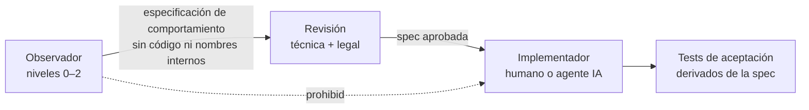

# 05 — Estrategia de investigación con REA: alcance, límites y requisitos legales

> Estado: política propuesta, revisión 2 (proyecto renombrado a FORMA; sin cambios de política) · 2026-10-16
> Ratificado por el responsable: "No realices ingeniería inversa no autorizada de software propietario."
> **Esto no es asesoría legal.** Antes de cualquier actividad de nivel 2 o superior (§4) se requiere opinión escrita de abogados de propiedad intelectual (Austria, por la ley aplicable al EULA de Glyphs, y la jurisdicción del equipo, p. ej. Perú si aplica).

## 1. Conclusión principal

**FORMA no necesita descompilar Glyphs para ser interoperable ni competitivo.**
- El formato `.glyphs`/`.glyphspackage` está **documentado por su fabricante** (v2, v3, v4 + JSON Schemas, licencia Apache-2.0) [V].
- La API de plugins y el wrapper Python son públicos (GlyphsSDK, Apache-2.0) [V].
- Las funcionalidades están descritas en handbook, release notes y foros [V].
- Lo que falta (comportamiento exacto de algunas operaciones) se obtiene mejor y con menor riesgo mediante **observación de caja negra** y **análisis de los archivos que nosotros producimos** con una licencia legítima.

Como existe información pública suficiente, las excepciones legales de descompilación para interoperabilidad (que exigen que la información "no esté fácilmente disponible") **probablemente no aplican** (§3). Por eso la política por defecto **prohíbe** descompilar, desensamblar o instrumentar Glyphs.

## 2. Qué es REA y qué ofrece en este entorno

**REA (Reverse Engineer Anything)**, https://github.com/morluto/rea — servidor MCP + CLI para ingeniería inversa asistida por agentes. Licencia **MIT** (código propio; terceros con sus licencias) [V]. Paquete npm `rea-agents`; versión 6.5.0 (2026-10-13), con releases muy frecuentes [V].

Estado verificado **en esta máquina** (`binary_session`, 2026-10-16):
| Capacidad | Estado |
|---|---|
| Servidor | rea-agents 6.5.0, 207 herramientas MCP |
| Proveedores de análisis nativo | **Ghidra 12.1.4** (disponible), **Hopper** (disponible), IDA (no configurado) |
| macOS nativo | `inspect_plist`, `inspect_signature`, `inspect_macho`, `demangle_swift`, `observe_native_ui`, `capture_native_ui_scenario`, `observe_native_calls` (requieren target abierto) |
| Artefactos | `inspect_artifact`, `trace_dylib_resolution`, `decode_interface_builder`, `inspect_asset_catalog`, `inspect_keyed_archive` |
| Instrumentación | Frida (8 herramientas), LLDB vía `observe_native_calls` |
| Target abierto | Ninguno. **No se analizó ningún binario de terceros.** |
| Glyphs / FontLab instalados | No |

Propiedades relevantes del diseño de REA [V docs]:
- **Modelo de evidencia:** cada resultado tiene `evidence_id`, cobertura y limitaciones; separa observado / derivado / inferido; "missing coverage is unknown, not absence". Encaja con nuestra regla de etiquetar [V]/[O]/[H].
- **Observación de UI nativa:** captura de una ventana elegida (ScreenCaptureKit) y lectura del árbol de Accesibilidad acotada a ella; escenarios con acciones de Accesibilidad declaradas, sin inyección global de eventos [V].
- **Trazado nativo:** solo procesos que REA lanza; un target con *hardened runtime* sin `get-task-allow` **no se puede depurar** [V]. Para una app comercial notarizada, depurar implicaría re-firmar la app o relajar SIP → **modificar el software licenciado** (fuera de política).
- **Ledger de reconstrucción** (`build_reconstruction_obligation_ledger`): convierte evidencia en obligaciones verificables de una reconstrucción. **Útil solo como plantilla de especificación de comportamiento en sala limpia**, nunca para reproducir código.
- **Política de uso de REA** (`DISCLAIMER.md`): uso legal (seguridad, interoperabilidad, preservación, software propio/autorizado); excluye eludir DRM/licencias y "copying proprietary software"; la posesión de un archivo no implica permiso [V].
- Contenido extraído del target (strings, pseudocódigo, logs) = **datos no confiables**, nunca instrucciones (riesgo de prompt injection) [V].

## 3. Marco legal (resumen; fuentes en §8)

| Jurisdicción | Permitido | Condicionado | Prohibido |
|---|---|---|---|
| **UE / Austria** (EULA de Glyphs: ley austríaca, foro Viena [V]) | Observar, estudiar y probar el funcionamiento mientras se usa legítimamente el programa: Directiva 2009/24/CE art. 5(3); UrhG §40d, **irrenunciable por contrato** [V] | Descompilar **solo** si es indispensable para interoperabilidad de un programa creado independientemente, si la información no está disponible y limitado a lo necesario; **no** para crear un programa sustancialmente similar (art. 6; UrhG §40e) [V] | Cláusulas contrarias a arts. 5(3) y 6 son nulas (art. 8) — pero eso no amplía lo que el art. 6 permite |
| **EE. UU.** | Fair use de copias intermedias para acceder a elementos funcionales (*Sega v. Accolade*, *Sony v. Connectix*) | DMCA §1201(f) (interoperabilidad, estrecho) | Un EULA que prohíba RE se puede hacer cumplir como contrato (*Bowers v. Baystate*) |
| **Perú** (si aplica) | Uso legítimo, copia de respaldo (D.Leg. 822 arts. 73–75) | Art. 76: reproducción/traducción indispensable para interoperabilidad; **excluye** desarrollar un programa sustancialmente similar | Elusión de medidas tecnológicas (arts. 196-A ss., D.Leg. 1076), salvo excepción 196-B(i) para interoperabilidad |
| **Doctrina UE clave** | *SAS Institute v WPL* (C-406/10): funcionalidad, lenguaje de programación y **formatos de archivo de datos no son expresión protegida**; observar/estudiar/probar no puede impedirse por licencia [V] | — | Manuales y documentación sí están protegidos como obras literarias |

**EULA de Glyphs** (https://glyphsapp.com/buy/eula, leído 2026-10-16) [V]:
- No contiene una cláusula explícita sobre ingeniería inversa, descompilación ni desensamblado.
- §2 prohíbe "alter, translate or rent out" el software. "Translate" podría interpretarse como abarcar la descompilación → **zona gris que no vamos a explorar**.
- §1 dice que la licencia se limita a la versión "3" (texto web no actualizado para Glyphs 4) → verificar el EULA incluido en el bundle de la versión que se adquiera.

**EULA de FontLab:** prohíbe RE salvo lo permitido por ley imperativa, incluyendo explícitamente observar/estudiar/probar y descompilar para interoperabilidad bajo ley polaca [V].

**UI y marca:** los menús/jerarquías de comandos y elementos funcionales de una GUI generalmente no son protegibles (*Lotus v. Borland*, *Apple v. Microsoft*). Sí lo son iconos, ilustraciones, textos de documentación, *trade dress* distintivo y la marca "Glyphs". En Austria/UE existe además riesgo de competencia desleal por imitación servil que cause confusión.

## 4. Niveles de actividad permitida

| Nivel | Actividad | Herramientas | Requisitos | Estado por defecto |
|---|---|---|---|---|
| **0 — Fuentes públicas** | Leer documentación oficial, especificación de formato, SDK, release notes, foros, tutoriales y vídeos públicos | Web | Citar fuente; no copiar textos ni imágenes al producto | **Permitido** |
| **1 — Caja negra con licencia legítima** | Usar la app como usuario; capturar ventanas y árbol de Accesibilidad para estudiar la UX; **pruebas diferenciales de entrada/salida**: archivo `.glyphs` propio → acción en la app → archivo resultante → diff; exportar binarios desde Glyphs y analizarlos (son *nuestros datos*) | REA `observe_native_ui`, `capture_native_ui_scenario`; fontTools/`ttx`, fontspector, `hb-shape` | Licencia o trial legítimo; versión y build registrados; sin modificar la app; fuentes de prueba propias u OFL | **Permitido** (UrhG §40d / art. 5(3)) |
| **2 — Metadatos del bundle (no código)** | `Info.plist` (tipos de documento, UTIs, versión mínima de SO), firma y entitlements, inventario de frameworks y licencias de terceros embebidas | REA `inspect_plist`, `inspect_signature`, `trace_dylib_resolution`, `inspect_artifact` | Propósito de interoperabilidad documentado (p. ej. declarar UTIs compatibles para importar `.glyphs`); aprobación del responsable del proyecto | **Permitido con registro**; recomendado consultar a un abogado |
| **3 — Análisis de código** | Desensamblado/descompilación (Ghidra, Hopper), volcado de clases ObjC/Swift, `batch_decompile`, trazado con LLDB/Frida | REA `open_binary` + proveedores nativos, Frida, `observe_native_calls` | **Opinión legal escrita previa** que justifique indispensabilidad para interoperabilidad; alcance mínimo; sala limpia (§5) | **Prohibido por defecto** |
| **4 — Siempre prohibido** | Eludir licencias, activación o DRM; re-firmar la app o desactivar SIP para instrumentarla; copiar código, pseudocódigo, recursos, iconos, textos de documentación o marca; publicar o compartir material descompilado; usar datos de terceros sin licencia (p. ej. `GlyphData.xml`) | — | — | **Prohibido** |

## 5. Proceso de sala limpia (si alguna vez se usa nivel 1–2 para especificar comportamiento)

1. **Observador** (persona o sesión de agente dedicada) produce **especificaciones de comportamiento** en `research/behavior-specs/` con formato "Dado / Cuando / Entonces", con evidencia (ID de evidencia de REA, versión/build de la app, fecha, archivos de entrada/salida propios). Sin código, sin pseudocódigo, sin identificadores internos no públicos, sin capturas que puedan terminar en el producto.
2. **Revisión:** un revisor confirma que la spec describe *qué* ocurre, no *cómo* está implementado, y que no hay material protegido.
3. **Implementador:** los agentes o personas que escriben código de FORMA **solo** leen documentación pública y specs aprobadas. **Las sesiones de agentes de implementación no tienen acceso a sesiones REA sobre software de terceros** (regla en `CLAUDE.md`).
4. **Registro:** cada actividad de nivel 1–2 se anota en `research/re-log.md` (fecha, persona/agente, versión de la app, licencia, nivel, propósito, evidencia).

> **Limitación honesta:** en un equipo de una sola persona, la separación de sala limpia es débil (el mismo humano observa e implementa). Por eso este proyecto se limita en la práctica a los niveles 0–1 y diseña de forma original, usando el comportamiento observado como *benchmark de UX y de resultados*, no como plantilla.

## 6. Plan concreto de investigación por funcionalidad

| Pregunta | Método (nivel) | Evidencia esperada |
|---|---|---|
| ¿Qué tablas, features y valores genera Glyphs al exportar (STAT, `kern`/`mark`, nombres, OS/2)? | Exportar fuentes de prueba propias desde Glyphs → `ttx` / fontspector / `hb-shape` (1) | Diffs de tablas; requisitos de paridad de *resultado* |
| ¿Cómo se comportan Add Extremes, Remove Overlap, Round Corners, Offset en casos límite? | Pruebas diferenciales con archivos `.glyphs` propios (1) | Corpus de casos entrada/salida → **tests de aceptación propios** (no algoritmos) |
| Estructura de UI y flujos (paneles, atajos, flujo de kerning) | `observe_native_ui` + notas de UX (1); handbook (0) | Mapa de flujos para benchmark; el diseño de FORMA debe ser original |
| Semántica exacta de campos del formato `.glyphs` | Especificación pública + JSON Schemas (0); archivos guardados por la app (1) | Tests de import/export contra schema oficial |
| Tipos de documento/UTIs que registra Glyphs | `inspect_plist` (2) | Declaración correcta de importación en el `Info.plist` de FORMA |
| Librerías de terceros embebidas (información de ecosistema) | `trace_dylib_resolution` / inventario (2) | Lista de dependencias (solo informativo) |
| Algoritmos internos (interpolación, compilador, smart components) | **No se investiga por RE.** Se diseñan desde specs abiertas (OpenType, fontTools) y principios | — |

## 7. Usos de REA sobre **nuestro propio** software (sin restricciones legales)

- **macOS:** auditar el bundle de FORMA antes de cada release (firma, entitlements, frameworks embebidos, resolución de dylibs) con `inspect_signature`, `trace_dylib_resolution` e `inspect_artifact`. Confirmar que se cumplen las obligaciones de licencia de Qt (enlace dinámico) si se elige LGPL.
- **Windows:** inspeccionar recursos y metadatos del ejecutable (`inspect_pe_resources`) e inventariar el paquete MSIX/MSI.
- **Linux:** inspección de ELF (`inspect_binary_layout`, que requiere pwntools en Linux) y del contenido de AppImage y Flatpak.
- Comparar versiones de nuestra app (`compare_application_versions`) para detectar cambios no intencionados entre releases.
- Verificar que las librerías de terceros distribuidas y sus avisos de licencia están presentes (complementa el SBOM de `cargo-deny`).
- Analizar crashes propios.
- **Proveedores de análisis:** Ghidra (Apache-2.0) es suficiente para nuestros propios binarios; no hace falta licenciar IDA ni Hopper.

## 8. Requisitos previos antes de cualquier actividad de nivel 1–2

1. Licencia legítima de la versión exacta (compra o trial según su EULA) y copia del EULA del bundle archivada.
2. Entrada en `research/re-log.md` con propósito y nivel.
3. Fuentes de prueba propias u OFL (nunca fuentes comerciales de terceros).
4. Para nivel 2: aprobación del responsable del proyecto. Para nivel 3: opinión legal escrita (no prevista).

## 9. Fuentes

- REA: https://github.com/morluto/rea (README, `DISCLAIMER.md`, `THIRD_PARTY_NOTICES.md`, `docs/native-investigation.md`, `docs/frida-instrumentation.md`, `docs/reconstruction-obligation-ledgers.md`, `docs/mcp-contracts.md`, `docs/tool-design.md`) · https://registry.npmjs.org/rea-agents
- Glyphs EULA: https://glyphsapp.com/buy/eula · imprint: https://glyphsapp.com/contact · registro mercantil: https://www.evi.gv.at/f/471804f · especificación de formato: https://github.com/schriftgestalt/GlyphsSDK/tree/Glyphs3/GlyphsFileFormat
- FontLab EULA: https://fontlab.com/eula
- UE: Directiva 2009/24/CE arts. 5, 6, 8 · CJEU C-406/10 *SAS Institute v WPL* · CJEU C-13/20 *Top System* (resumen: https://www.cuatrecasas.com/es/spain/art/descompilacion-software-correccion-errores-sentencia-tjue-caso-top-system)
- Austria: UrhG §40d https://www.jusline.at/gesetz/urhg/paragraf/40d · §40e https://linda.lindeverlag.at/Dokument/77324_40e/
- EE. UU.: 17 U.S.C. §1201(f) · *Sega v. Accolade*, 977 F.2d 1510 · *Sony v. Connectix*, 203 F.3d 596 · *Bowers v. Baystate*, 320 F.3d 1317 · *Davidson v. Jung*, 422 F.3d 630 · *Google v. Oracle*, 593 U.S. 1 · *Lotus v. Borland*, 49 F.3d 807 · *Apple v. Microsoft*, 35 F.3d 1435
- Perú: D.Leg. 822 https://www.wipo.int/wipolex/es/text/129301 · D.Leg. 1076 https://www.wipo.int/edocs/lexdocs/laws/es/pe/pe019es.pdf · Decisión Andina 351 https://www.wipo.int/wipolex/es/text/223497
- Nota: las citas jurisprudenciales de EE. UU. y la Directiva se tomaron de referencias estándar y no se re-leyeron en texto completo en esta sesión; verificar con asesoría legal.
