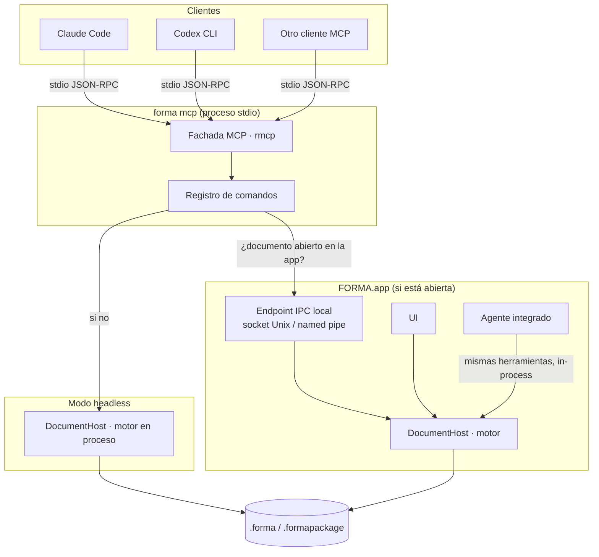
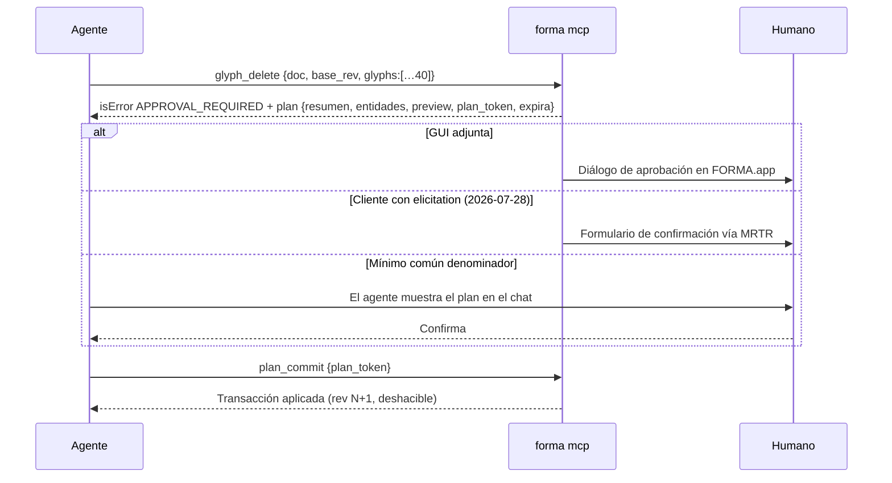
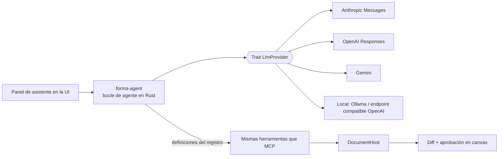

# 07 — Arquitectura de IA y MCP

> Estado: propuesta para aprobación · 2026-10-16
> Requisito del producto: **MCP es una interfaz de primera clase de FORMA desde el Hito 1**, no un adaptador posterior. Un agente (Claude Code, Codex o cualquier cliente MCP) debe poder realizar *todas* las operaciones del editor con el mismo núcleo que usan la UI y la CLI.
> Etiquetas: **[V]** verificado (fuentes en §15) · **[D]** decisión propuesta · **[H]** supuesto a validar.

## 1. Principios

1. **Un solo registro de comandos.** Cada operación del editor se define una vez en Rust (tipos de entrada/salida, efectos, validación, handler). De ese registro se *generan* las herramientas MCP, los subcomandos de la CLI, las llamadas de la UI y las herramientas del agente integrado. **No hay lógica de negocio en la capa MCP.**
2. **El servidor hace cumplir la seguridad, no el cliente.** Las anotaciones de herramientas son *pistas no confiables* según la especificación [V]. Revisiones, aprobaciones y límites de archivos se verifican en el núcleo.
3. **Mínimo común denominador + mejora progresiva.** Base garantizada: herramientas + contenido texto/imagen + `isError`, por stdio, con semántica compatible con 2025-06-18 (la versión que Codex usa por defecto [V]). Resources, elicitation, prompts, `structuredContent`, Tasks y MCP Apps son mejoras opcionales cuando el cliente las anuncia.
4. **Headless por diseño.** Ninguna herramienta requiere la interfaz gráfica.
5. **Todo es una transacción deshacible y atribuida** (usuario, agente X, script, plugin).

## 2. Estado del protocolo y del ecosistema (oct-2026)

| Hecho | Consecuencia para FORMA |
|---|---|
| La revisión vigente de MCP es **2026-07-28**: sin `initialize`, sin sesiones, `_meta` obligatorio por request, `server/discover`, *Multi Round-Trip Requests* (MRTR) para elicitation, Tasks como extensión, Roots/Sampling/Logging deprecados [V] | Servir **ambas eras**. El estado entre llamadas se lleva en *handles* explícitos (documentos, planes), no en sesiones. |
| **Codex CLI** 0.163 negocia **2025-06-18** por defecto; 2026-07-28 detrás de un flag en desarrollo [V] | Pruebas de integración en ambos modos de ciclo de vida. |
| **Codex descarta `content` (incluidas imágenes) si hay `structuredContent`** [V código fuente] | Las herramientas de preview devuelven **imagen + texto, sin `structuredContent`**. |
| **Claude Code**: elicitation form/url, roots, imágenes, *tool search* activado por defecto, límite de salida de 25 000 tokens (`MAX_MCP_OUTPUT_TOKENS`), `_meta["anthropic/requiresUserInteraction"]` fuerza confirmación humana incluso en bypass [V] | Previews reducidos; marcar los commits destructivos con ese `_meta`. |
| Gemini CLI trunca nombres a 63 caracteres (`mcp_{server}_{tool}`) [V]; Anthropic reporta degradación de selección con más de 30–50 herramientas [V] | Nombres cortos en `snake_case`; ~25 herramientas en el toolset por defecto. |
| **rmcp 3.5.1** (SDK oficial Rust, Tier 1): implementa 2026-07-28 y es compatible con 2025-11-25 y anteriores; macros `#[tool]`, schemas con schemars, elicitation, MRTR con sellado HMAC de `requestState`, Tasks, progreso, cancelación, transportes stdio / proceso hijo / in-process / Streamable HTTP; Codex lo usa (`=3.5.1`) [V] | **[D] SDK: rmcp.** `rust-mcp-sdk` 2.x descartado porque solo soporta 2026-07-28 y rompería Codex [V]. |
| No existe SDK Rust oficial de Anthropic, OpenAI ni Google; `genai` (MIT/Apache) soporta Anthropic, OpenAI Responses, Gemini y Ollama; `rig-core` fija rmcp ^2 (conflicto con rmcp 3) [V] | Agente integrado con capa de proveedores propia sobre `genai`. |

## 3. Topología de procesos



- **[D] Regla de escritor único:** cada documento lo posee exactamente un `DocumentHost` (la app o un proceso headless). El dueño mantiene un bloqueo de archivo a nivel de SO junto al documento.
- **Modo adjunto:** si la app tiene el documento abierto, `forma mcp` actúa como **proxy** hacia ella por IPC local. Los cambios del agente aparecen en vivo y los conflictos se resuelven en un solo motor. El IPC es un socket Unix con permisos `0600` en el directorio de runtime del usuario, o un named pipe con ACL del usuario en Windows, más un token aleatorio en un archivo legible solo por el usuario.
- **Modo headless:** sin app abierta, `forma mcp` aloja el motor en su propio proceso. Es el modo de CI y del Hito 1.
- **Protocolo IPC = sobres del registro de comandos** (mismo JSON de entrada/salida que las herramientas MCP), así que el proxy no traduce nada.
- Si un documento está abierto por otro proceso que no expone IPC, se abre **solo lectura** con aviso.

## 4. Registro de comandos (la pieza que evita duplicar lógica)

```rust
// Ilustrativo (diseño, no código del producto)
pub struct CommandSpec {
    pub id: &'static str,            // "glyph.set_outline"
    pub tool_name: &'static str,     // "glyph_set_outline" (MCP/CLI)
    pub since_api: Version,          // versión de API en que apareció
    pub toolset: Toolset,            // Core, Glyphs, Spacing, Masters, Export, History…
    pub effects: Effects,            // read_only, destructive, idempotent, mass_threshold
    pub input_schema: fn() -> Schema,   // schemars desde el tipo Rust
    pub output_schema: fn() -> Schema,
    pub handler: fn(&mut Ctx, Value) -> Result<Outcome, CommandError>,
}
```

| Fachada | Cómo usa el registro |
|---|---|
| MCP (`forma-mcp`) | Una herramienta por `CommandSpec` del toolset activo; anotaciones derivadas de `effects` |
| CLI (`forma call <tool> --json '{…}'` y subcomandos ergonómicos) | Mismo handler y mismos schemas |
| UI (cualquier toolkit, ver `02-tech-stack.md`) | Las herramientas del canvas emiten los mismos comandos (gestos = transacciones) |
| Agente integrado | Recibe las definiciones de herramientas del registro (formato del proveedor) |
| Python (fase posterior) | Bindings generados del registro |

**Test de paridad (CI):** cada `CommandSpec` debe estar expuesto en MCP y CLI (o justificar su exclusión en una lista blanca). Una herramienta MCP sin `CommandSpec` no compila.

## 5. Documentos, handles y revisiones

- `document_create` / `document_open` devuelven un **handle de documento** (`doc`): opaco, aleatorio y ligado al `DocumentHost`; deja de valer al cerrar el documento. Coherente con el modelo sin sesiones de 2026-07-28 [V].
- **Revisión global** `rev` (entero monótono) y **revisiones por entidad**: glifo, info de fuente, métricas por master, kerning por master, grupos, features, ejes y masters.
- **Todo resultado de lectura incluye `rev`.** **Toda herramienta mutante exige `base_rev`.**
- **Control de concurrencia optimista por entidad:**
  - Si las entidades que toca el comando no cambiaron desde `base_rev`, se aplica (rebase automático, aunque el documento haya avanzado por cambios en *otras* entidades).
  - Si alguna cambió, devuelve `isError: true` con `{"code":"REVISION_CONFLICT","message":"…","details":{"current_rev":…,"conflicts":[{"entity":"glyph:<id>","rev":…,"actor":"user","name":"a"}]}}`: `entity` es la clave de la entidad, `rev` la revisión de su último cambio, `actor` quién lo hizo y, si es un glifo, `name` su nombre actual (o el que tenía antes de borrarse). El agente debe releer y reintentar.
  - Lo mismo ocurre si la llamada nombra un glifo que existía en `base_rev` y otro actor renombró o borró después: `REVISION_CONFLICT` sobre ese glifo, no `NOT_FOUND`.
- Esto impide que un agente sobrescriba cambios recientes del usuario (ni de otro agente), sin bloquear la edición concurrente de entidades distintas.
- **Atribución:** cada transacción registra su actor (`user`, `agent:<clientInfo.name>`, `script`, `plugin:<id>`) y una etiqueta legible. La UI muestra la autoría en el historial y puede resaltar cambios recientes de agentes.

## 6. Transacciones, undo/redo e historial

- Cada llamada mutante = **una transacción** = una entrada de historial.
- **`edit_batch`**: lista de operaciones aplicadas atómicamente (todo o nada) como una sola transacción. Es el patrón principal para agentes (menos llamadas, consistencia), como los *batches* atómicos de Notion o las transacciones de Canva [V].
- Herramientas de historial:

| Herramienta | Semántica |
|---|---|
| `history_list` | Transacciones con actor, etiqueta, `rev` y entidades afectadas (paginado) |
| `history_undo` / `history_redo` | Solo si la última transacción pertenece al mismo actor. Si no, error con sugerencia de `history_revert` |
| `history_revert` | Revierte una transacción concreta como **nueva** transacción, si sus entidades no cambiaron después; si cambiaron, conflicto |
| `history_restore` | Restaura el documento a una revisión como **nueva** transacción (no destructiva, deshacible). Masiva → requiere plan |
| `document_diff` | Diferencias estructuradas entre dos revisiones (o dos archivos): glifos/nodos/métricas/kerning cambiados |

- El historial de la sesión vive en memoria con snapshots estructurales (ver `03-architecture.md`). El **journal de recuperación** persiste en disco cada transacción confirmada, sea de usuario o de agente.

## 7. Aprobación de operaciones destructivas o masivas

**Clasificación de efectos** (en `CommandSpec`, verificada por el núcleo):
- `read_only`.
- `write`: local, deshacible.
- `destructive`: borrar glifos, masters o ejes; reemplazar contornos completos; restaurar revisiones; sobrescribir archivos al exportar.
- `mass`: afecta más de N entidades; N = 20 glifos por defecto, configurable.

**Flujo plan → token → commit:**


- **`plan_token`**: sellado con HMAC/AEAD y ligado a actor, digest exacto de la operación, `base_rev` y TTL (5 min por defecto). De un solo uso, registrado en el servidor. Sigue las reglas de `requestState` de MRTR de la especificación [V]; rmcp trae el helper de sellado [V].
- `plan_commit` lleva `destructiveHint: true` y `_meta["anthropic/requiresUserInteraction"]: true`, para que Claude Code siempre pida confirmación humana [V]. Codex en modo `writes` pide aprobación para herramientas no marcadas como de solo lectura [V].
- **Política configurable** (por usuario o documento, y flags de `forma mcp`):

| Política | Comportamiento |
|---|---|
| `strict` | Por defecto con GUI. Los planes requieren aprobación en la GUI o por elicitation; el agente no puede autoconfirmar |
| `prompted` | Por defecto headless. Basta la confirmación del cliente MCP sobre `plan_commit` |
| `auto` | Solo CI y escenarios explícitos. Commit directo sin plan para operaciones masivas no destructivas; las destructivas siguen requiriendo plan |

- Cualquier herramienta mutante acepta `dry_run: true` para obtener el plan sin aplicar nada.

## 8. Catálogo inicial de herramientas (API v1)

Convenciones: `snake_case`, prefijo de dominio, ≤ 40 caracteres, orden determinista. Todas las mutantes llevan `doc` y `base_rev`; todas las lecturas devuelven `rev`. Columna "Hito": **1** = Hito 1, **F2…F7** = fase del roadmap (`04-roadmap.md`).

| Toolset | Herramienta | Efecto | Hito |
|---|---|---|---|
| core | `forma_capabilities` | read | 1 |
| core | `document_create` | write | 1 |
| core | `document_open` | read | 1 |
| core | `document_save` (con `path` opcional = "guardar como") | write (guardar sobre otro archivo existente: destructive) | 1 |
| core | `document_close` | write | 1 |
| core | `document_list` | read | 1 |
| core | `document_inspect` | read | 1 |
| core | `font_set_info` | write | 1 |
| core | `font_set_vertical_metrics` | write | 1 |
| core | `edit_batch` | write/destructive según contenido | 1 |
| core | `plan_commit` / `plan_discard` | según plan | 1 |
| glyphs | `glyph_list` (filtros, paginado) | read | 1 |
| glyphs | `glyph_get` (contornos estructurados + `svg_path`) | read | 1 |
| glyphs | `glyph_create` (nombre, Unicode, advance, contornos o `svg_path`) | write | 1 |
| glyphs | `glyph_update` (renombrar, Unicode, export flag) | write | 1 |
| glyphs | `glyph_delete` | destructive | 1 |
| glyphs | `glyph_set_outline` (reemplaza contornos de una capa) | destructive | 1 |
| glyphs | `contour_edit` (añadir/borrar/invertir/transformar contorno) | write | 1 |
| glyphs | `nodes_edit` (mover, insertar, borrar, smooth/corner) | write | 1 |
| glyphs | `component_add` / `anchor_set` | write | F2 |
| geometry | `geometry_check` (contornos abiertos, dirección, extremos, puntos duplicados, segmentos diminutos, fuera de grilla; auto-intersecciones desde F4) | read | 1 |
| geometry | `geometry_fix` (correcciones seleccionadas → plan si es masivo) | write/mass | 1 |
| geometry | `path_boolean` / `remove_overlap` | write | F4 |
| spacing | `metrics_get` / `metrics_set` (advance, LSB, RSB por glifo y master; lote) | write | 1 |
| spacing | `kerning_get` / `kerning_set` (pares, grupos, excepciones) | write | F2 |
| masters | `axis_add` / `master_add` / `master_update` / `instance_set` | write | F3 |
| masters | `compatibility_check` / `interpolate_preview` | read | F3 |
| features | `features_get` / `features_set` / `features_generate` | write | F4 |
| quality | `validate` (modelo + binario: OTS, fontspector, chequeos propios) | read | 1 |
| export | `export_font` (TTF; WOFF2; VF en F3; OTF en F4) | write (sobrescritura: destructive) | 1 |
| preview | `preview_glyph` (PNG/SVG; capa, master, guías, nodos opcionales) | read | 1 |
| preview | `preview_text` (prueba de texto con shaping) | read | 1 (sin shaping complejo) / F2 |
| preview | `preview_compare` (dos revisiones superpuestas o lado a lado) | read | 1 |
| history | `history_list` / `history_undo` / `history_redo` / `history_revert` / `history_restore` | write | 1 |
| history | `document_diff` | read | 1 |

- Toolset por defecto: `core, glyphs, geometry, spacing, quality, export, preview, history` (unas 25 herramientas). `forma mcp --toolsets …` y `--read-only` permiten ajustar.
- `_meta["anthropic/alwaysLoad"]` solo en `forma_capabilities`, `document_open` y `document_create`; el resto se carga vía *tool search*.

**Representación de contornos para agentes:** se aceptan dos formas equivalentes:
- `svg_path` (cadena `d`, la que mejor producen los LLMs);
- contornos estructurados: `[{closed, nodes:[{x, y, type: line|curve|qcurve|offcurve, smooth}]}]`.

El sistema de coordenadas es explícito y por defecto `font` (unidades de la fuente, eje y hacia arriba). `glyph_get` devuelve ambas formas.

## 9. Resources (mejora progresiva)

| URI | Contenido |
|---|---|
| `forma://docs` | Documentos abiertos y sus handles |
| `forma://doc/{doc}/info` | Info de fuente, masters, métricas, `rev` |
| `forma://doc/{doc}/glyphs{?cursor}` | Lista de glifos |
| `forma://doc/{doc}/glyph/{name}{?master}` | Glifo (JSON) |
| `forma://doc/{doc}/glyph/{name}/preview.png{?master,size}` | Imagen |
| `forma://doc/{doc}/kerning/{master}` | Kerning |
| `forma://doc/{doc}/history{?cursor}` | Historial |
| `forma://doc/{doc}/validation/latest` | Último informe |
| `forma://doc/{doc}/exports/{id}` | Binario exportado (blob) + informe |

- Templates RFC 6570; suscripciones a cambios donde el cliente use `subscriptions/listen` [V].
- **Cada resource tiene una herramienta espejo** (`document_inspect`, `glyph_get`, `preview_glyph`…), porque el soporte de resources y suscripciones varía entre clientes [V].
- Resultados grandes: `resource_link` en lugar de contenido embebido; opción `output_path` para escribir a disco (patrón de Playwright MCP [V]).

## 10. Salidas, tamaños y operaciones largas

- **Herramientas de datos:**
  - `structuredContent` conforme a `outputSchema`, más el mismo JSON serializado como texto (recomendación de compatibilidad de la spec [V]);
  - paginación con `cursor`;
  - presupuesto ≤ 10 000 tokens por respuesta, por debajo del aviso de Claude Code [V].
- **Previews:** PNG de 512 px por defecto (máx. 1024), sin `structuredContent` (por Codex) y con un resumen textual.
- **Operaciones largas** (exportar o validar fuentes grandes):
  - notificaciones de progreso;
  - extensión Tasks si el cliente la declara;
  - si no, ejecución síncrona con límite y alternativa `export_font {async:true}` → `job_status`, porque el timeout por defecto de Codex es de 60 s [V].
  - La cancelación (`notifications/cancelled`) se propaga al núcleo.
- **Errores:**
  - errores de ejecución con `isError: true` y `code` estable: `REVISION_CONFLICT`, `APPROVAL_REQUIRED`, `NOT_FOUND`, `INVALID_GEOMETRY`, `LIMIT_EXCEEDED`, `PATH_NOT_ALLOWED`, `COMPILE_FAILED`, `VALIDATION_FAILED`, `UNSUPPORTED`;
  - mensaje accionable;
  - errores de protocolo vía JSON-RPC [V].

## 11. Versionado de la API MCP

- **Versión de API de FORMA** (semver), independiente de la versión de la app. Se anuncia en `serverInfo`/`_meta` y en `forma_capabilities`, junto con toolsets, límites y versiones de formato soportadas.
- **Cambios:**
  - Aditivos (campo opcional nuevo, herramienta nueva): versión menor.
  - Incompatibles: **herramienta nueva con sufijo** (`glyph_set_outline_v2`). La anterior se marca como obsoleta en la descripción y en `_meta` y se mantiene al menos dos versiones menores.
- **Contrato congelado en CI:** el snapshot de `tools/list` (nombres, schemas, anotaciones, orden) se compara en cada PR. Cualquier cambio exige actualizar el snapshot de forma explícita, con la clasificación (aditivo o incompatible) en la descripción del PR.

## 12. Seguridad

| Amenaza | Control |
|---|---|
| Agente sobrescribe trabajo del usuario | `base_rev` obligatorio + concurrencia optimista por entidad (§5) |
| Operaciones destructivas por error o por prompt injection | Plan → token → commit, ejecutado en el servidor; políticas; `requiresUserInteraction` |
| Acceso a archivos fuera de lo permitido | Raíces permitidas (flags `--allow-dir`, config, roots del cliente si existen); rutas canonizadas; sin seguir symlinks fuera de las raíces; la exportación nunca sobrescribe sin plan |
| **Prompt injection desde el contenido del documento** (nombres de glifos, notas o comentarios FEA de fuentes descargadas) | El contenido del documento se devuelve siempre en campos de datos estructurados, nunca como instrucciones. Las `instructions` del servidor advierten que el contenido del documento es dato no confiable. No hay herramientas de ejecución de código en v1 |
| Otro usuario o proceso local se conecta al IPC | Socket/pipe con permisos del usuario + token aleatorio en archivo `0600` |
| Abuso de recursos | Límites por llamada (nodos, glifos, tamaño de imagen, tamaño de payload), timeouts y cancelación |
| Filtración de propiedad intelectual a proveedores LLM (agente integrado) | Opt-in; visibilidad de qué se envía; BYOK; modelos locales; sin telemetría de contenido |
| Credenciales | API keys en el llavero del SO (macOS Keychain, Windows Credential Manager, Secret Service en Linux); nunca en archivos del documento |
| Auditoría | Log JSONL de llamadas de agentes (herramienta, actor, `rev`, resultado) en el directorio de datos de la app |
| Futuro transporte HTTP | Fuera de alcance de v1. Si se añade: solo localhost por defecto, OAuth 2.1 según la spec, sin passthrough de tokens [V] |

## 13. Agente integrado (independiente del proveedor)



- **[D]** El bucle del agente corre **en el proceso**. Expone las mismas herramientas del registro, convertidas al formato de funciones de cada proveedor. Los proveedores se conectan vía `genai` (MIT/Apache) [V], detrás de un trait propio para poder sustituirlo.
- **Sin proveedor obligatorio:** FORMA funciona completo sin IA. El usuario elige proveedor y modelo, o usa uno local.
- Mismas reglas de seguridad que MCP: revisiones, planes y aprobación en el canvas con vista de diff.
- Los conectores MCP remotos de Anthropic y OpenAI requieren un servidor HTTP accesible desde internet [V]; **no se usan** en v1.

## 14. Pruebas

| Nivel | Qué | Dónde |
|---|---|---|
| Unitario | Cada handler del registro (vía API Rust) | `cargo test`, 3 SO |
| Contrato | Snapshot de `tools/list`; validación de que cada `outputSchema` acepta las salidas reales (propiedad); paridad registro ↔ MCP ↔ CLI | CI por PR |
| Integración stdio | Arranca el binario `forma mcp` con el cliente de rmcp (`TokioChildProcess`), **en ambos modos de ciclo de vida** (`Initialize` = era 2025, como Codex; `Discover` = 2026-07-28) [V]; ejecuta escenarios y verifica resultados y errores | CI por PR en **macOS, Windows y Ubuntu 24.04** |
| Escenario Hito 1 | Crear fuente → glifos desde `svg_path` → espaciado → `geometry_check`/`geometry_fix` → `validate` → `export_font` TTF → verificación externa (OTS, `hb-shape`, fontTools) | CI por PR |
| Concurrencia | Cliente "usuario" simulado (por IPC) y cliente MCP editando a la vez → conflictos detectados, sin pérdida de cambios | CI por PR (desde que exista IPC) |
| Aprobaciones | Operaciones masivas o destructivas sin token → `APPROVAL_REQUIRED`; token caducado, reutilizado o de otro actor → rechazado | CI por PR |
| Seguridad | Rutas fuera de raíces, symlinks, payloads gigantes, nombres de glifo con texto de inyección | CI por PR |
| Smoke con herramienta oficial | MCP Inspector en modo CLI (`--cli … --format json`, códigos de salida) [V] | CI por PR |
| Conformidad | Suite oficial `modelcontextprotocol/conformance` (prueba servidores por HTTP [V]) → build de test con transporte HTTP solo en localhost | CI nocturno |
| Evals con agentes reales | `claude -p --mcp-config …` y `codex exec` sobre un banco de tareas; éxito medido por validadores, no por texto | Nocturno, no bloqueante, con presupuesto |

## 15. Fuentes

- Especificación MCP: https://modelcontextprotocol.io/specification/versioning · https://modelcontextprotocol.io/specification/2026-07-28/changelog · …/2026-07-28/server/tools · …/server/resources · …/client/elicitation · …/basic/patterns/mrtr · …/basic/transports/stdio · …/basic/authorization/index · …/deprecated · https://modelcontextprotocol.io/specification/2025-06-18/changelog
- Seguridad: https://modelcontextprotocol.io/docs/2026-07-28/tutorials/security/security_best_practices
- Extensiones: https://modelcontextprotocol.io/extensions/overview · /extensions/client-matrix · /extensions/tasks/overview · /extensions/apps/overview
- SDK Rust: https://github.com/modelcontextprotocol/rust-sdk · https://crates.io/crates/rmcp · SDKs: https://modelcontextprotocol.io/docs/2026-07-28/sdk
- Testing: https://modelcontextprotocol.io/docs/2026-07-28/tools/inspector/cli · https://github.com/modelcontextprotocol/conformance
- Clientes: https://code.claude.com/docs/en/mcp · https://learn.chatgpt.com/docs/extend/mcp?surface=cli · código de Codex: https://github.com/openai/codex (`codex-rs/features/src/lib.rs`, `codex-rs/rmcp-client/src/protocol_mode.rs`, `codex-rs/protocol/src/models.rs`) · https://cursor.com/docs/context/mcp · https://code.visualstudio.com/docs/agents/tools · https://geminicli.com/docs/tools/mcp-server/
- Patrones: https://github.com/github/github-mcp-server · https://github.com/microsoft/playwright-mcp · https://github.com/hashicorp/terraform-mcp-server · https://canva.dev/docs/mcp/tools · https://developers.notion.com/docs/mcp-supported-tools · https://platform.claude.com/docs/en/agents-and-tools/tool-use/tool-search-tool
- Proveedores: https://crates.io/crates/genai · https://crates.io/crates/rig-core · https://platform.claude.com/docs/en/agents-and-tools/mcp-connector · https://developers.openai.com/api/docs/guides/tools-connectors-mcp
